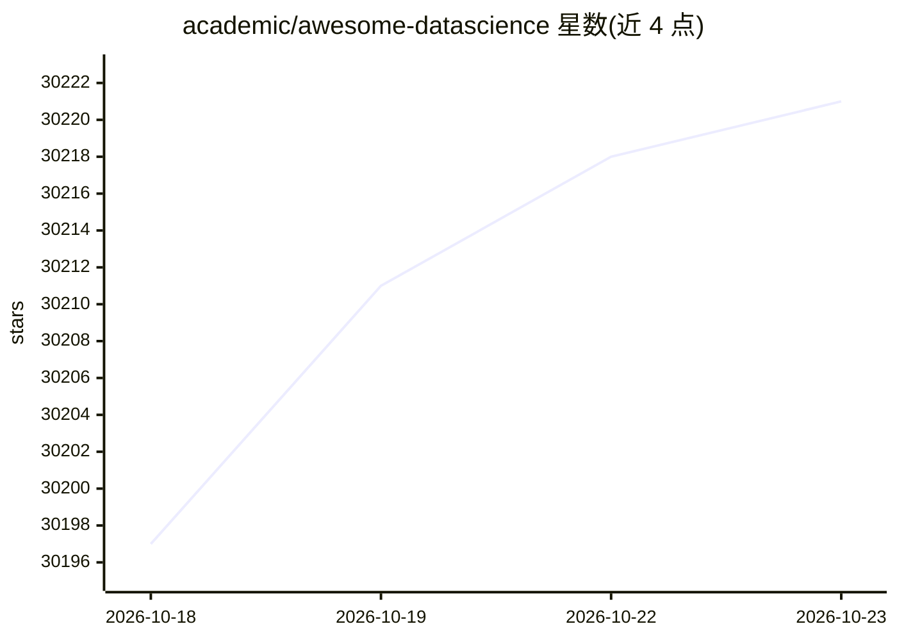

# academic/awesome-datascience

⭐ 30,221 · MIT · 推送 2026-10-18 · [GitHub](https://github.com/academic/awesome-datascience) · 组织维护

**数据科学学习与资源策展清单（awesome list）**

开源数据科学资源聚合仓库：回答"什么是数据科学、如何入门"，收录定义性文章链接、Python/R 起步指南、入门路线图（先 Python 与核心库，再练 Kaggle 项目，后学 ML），并按类别收录工具清单，包括 Agents 章节（agent 框架、工具、研究检索与工作流类条目）。面向数据科学学习者与从业者，通过贡献指南接受社区增补。

## 筛选速览

| 维度 | 判定 | 备注 |
|---|---|---|
| AI 角色 | `ai-knowledge` | 知识聚合/清单类 |
| 许可风险 | `permissive` | MIT |
| 部署形态 | `library` | 以包/库形式分发 |
| 模型依赖 | — | README 未给出锁定关系 |
| 硬件要求 | — | 无带数字的原话,不猜 |
| 安装摩擦 | `low` | 无编译、无系统依赖或容器化 |
| 成熟度 | — | 结构信号不足 |

## 动量与使用信号

- 维护:`active` — 距上次 push 0.8 天,年发版 12,329 位贡献者
- 涨星:近 1 天 **+7**(自 20261016 起算)
- 安装:github 包 `release-assets` 月下载无数据
- 平台:— · 协议:OPENAI-API / MCP / OLLAMA

## 能力要点

- 收录数据科学定义、入门文章与免费课程等链接资源
- 提供从 Python 基础到深度学习的入门路线图
- Agents 章节收录 agent 框架、工具、研究检索类条目

## 适用场景

- 按路线图自学数据科学入门
- 查找数据科学相关工具与 agent 框架
- 了解数据科学领域的课程与文章资源

## 场景标签

`精选清单` · 领域:学习与行业

## 证据(README 行号)

> L7: **An open-source Data Science repository to learn and apply concepts toward solving real- world problems.**
> L9: This is a shortcut path to start studying **Data Science**. Just follow the steps to answer the questions, "What is 

## 星数曲线

2026-10-18 30,197 → 2026-10-23 30,221（+24）

---
*卡片 v1 · prompt 1.4 · 生成 2026-10-20 · 置信度 mid · 依据 README sha `8a72432a6535` · [字段定义](../../DATASET.md)*
