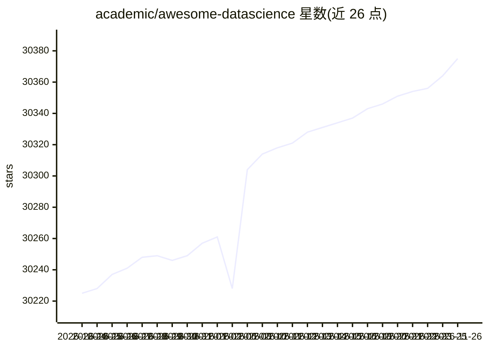

# academic/awesome-datascience

⭐ 30,375 · MIT · 推送 2026-11-24 · [GitHub](https://github.com/academic/awesome-datascience) · 组织维护

**数据科学学习资源清单：帮初学者系统入门与应用**

一个开源的数据科学资源聚合仓库，以问答形式组织（什么是数据科学、从哪里开始学），收录专家文章链接、语言选择建议（Python/R）、入门工具（Scikit-Learn、Pandas、NumPy、Seaborn）以及新手学习路线图。可见部分还包含 Agents 分类，列举用于数据科学工作流的 agent 框架、工具与研究检索类项目。欢迎社区贡献，附带 CONTRIBUTING.md。

## 筛选速览

| 维度 | 判定 | 备注 |
|---|---|---|
| AI 角色 | `ai-knowledge` | 知识聚合/清单类 |
| 许可风险 | `permissive` | MIT |
| 部署形态 | `library` | 以包/库形式分发 |
| 模型依赖 | — | README 未给出锁定关系 |
| 硬件要求 | — | 无带数字的原话,不猜 |
| 安装摩擦 | `low` | 无编译、无系统依赖或容器化 |
| 成熟度 | — | 结构信号不足 |

## 动量与使用信号

- 维护:`active` — 距上次 push 0.8 天,年发版 12,329 位贡献者
- 涨星:近 1 天 **+7**(自 20261016 起算)
- 安装:github 包 `release-assets` 月下载无数据
- 平台:— · 协议:OPENAI-API / MCP / OLLAMA

## 能力要点

- 以"什么是数据科学/从哪开始"问答组织入门路径
- 提供 Python/R 语言与核心库（Pandas、NumPy、Scikit-Learn）入门指引
- 含 Beginner Roadmap 五步学习路线
- 设 Agents 分类，收录数据科学工作流相关框架与工具

## 适用场景

- 作为初学者系统入门数据科学的学习路线参考
- 查找数据科学概念解释与专家文章资源
- 寻找可用于数据科学工作流的 agent 工具

## 场景标签

`精选清单` · 领域:学习与行业

## 证据(README 行号)

> L9: **An open-source Data Science repository to learn and apply concepts toward solving real- world problems.**
> L11: This is a shortcut path to start studying **Data Science**. Just follow the steps to answer the questions, "What is
> L22: ## Table of Contents

## 星数曲线

2026-10-24 30,225 → 2026-11-26 30,375（+150）

---
*卡片 v1 · prompt 1.4 · 生成 2026-11-26 · 置信度 mid · 依据 README sha `615e3b08e860` · [字段定义](../../DATASET.md)*
