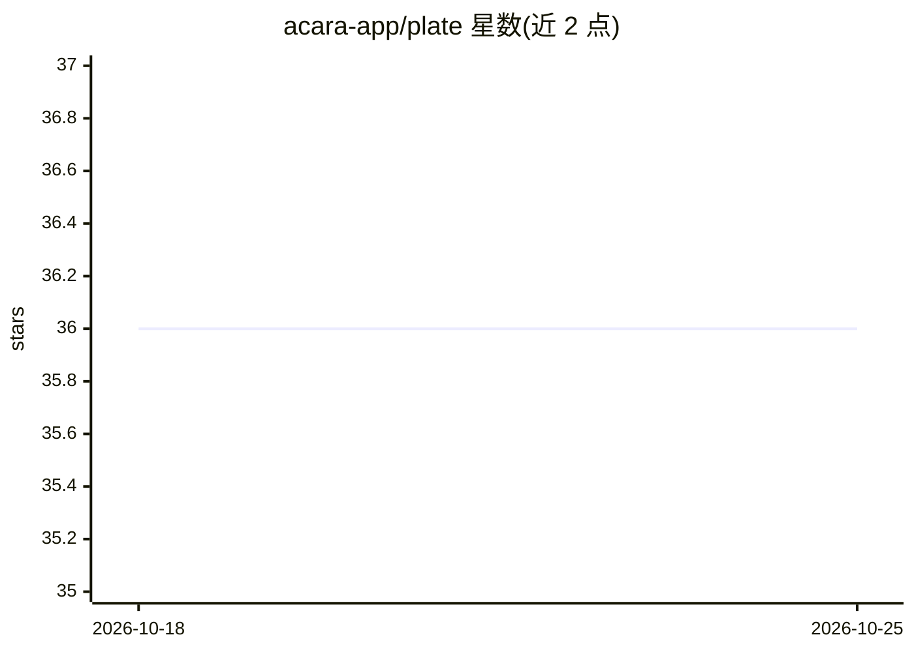

# acara-app/plate

⭐ 36 · PHP · NOASSERTION · 推送 2026-10-25 · [GitHub](https://github.com/acara-app/plate) · [官网](https://plate.acara.app) · 组织维护

**可自托管的健康 AI 代理平台：问答、健康数据接入与营养指导**

基于 Laravel 13 + React/Inertia 的自托管健康 AI 代理平台：以对话形式回答症状、用药、营养等健康问题，接入用户授权的血糖、睡眠、活动等个人数据作为上下文，提供 AI 营养师、AI 健康教练、AI 餐食规划、Telegram 聊天与记录、Apple Health 同步（配套 iOS 应用）及食物照片多模态分析（营养估算基于 USDA FoodData Central）。异步代理执行、WebSocket 流式输出、PostgreSQL 单一事实源。许可证为 O'Saasy，限制提供竞争性托管 SaaS；声明非医疗设备。

## 筛选速览

| 维度 | 判定 | 备注 |
|---|---|---|
| AI 角色 | `ai-native` | 本体是模型或模型工具 |
| 许可风险 | `none` | NOASSERTION |
| 部署形态 | `self-host` | docker 或自建部署 |
| 模型依赖 | — | README 未给出锁定关系 |
| 硬件要求 | — | 无带数字的原话,不猜 |
| 安装摩擦 | `low` | 无编译、无系统依赖或容器化 |
| 成熟度 | — | 结构信号不足 |

## 能力要点

- AI 代理整合个人健康数据上下文回答健康问题
- Telegram 自然语言健康记录（血糖/胰岛素/用药等转结构化条目）
- 食物照片多模态分析，营养值标注参考来源或模型估算
- Apple Health 经配套 iOS 应用加密同步至 Plate 实例

## 适用场景

- 自托管一个整合我个人健康数据的 AI 健康问答助手
- 通过 Telegram 记录血糖、饮食、用药并获取指导
- 获得面向代谢健康与糖尿病的营养和餐食规划建议

## 场景标签

`聊天机器人` · 领域:对话与助手

## 证据(README 行号)

> L11: Acara Plate is a self-hostable health AI agent platform for asking health questions, connecting personal health dat
> L30: - Answer health questions in plain language about symptoms, conditions, medications, vaccines, nutrition, mental he

## 星数曲线

2026-10-18 36 → 2026-10-25 36（+0）

---
*卡片 v1 · prompt 1.4 · 生成 2026-10-25 · 置信度 high · 依据 README sha `c95910ea69bd` · [字段定义](../../DATASET.md)*
