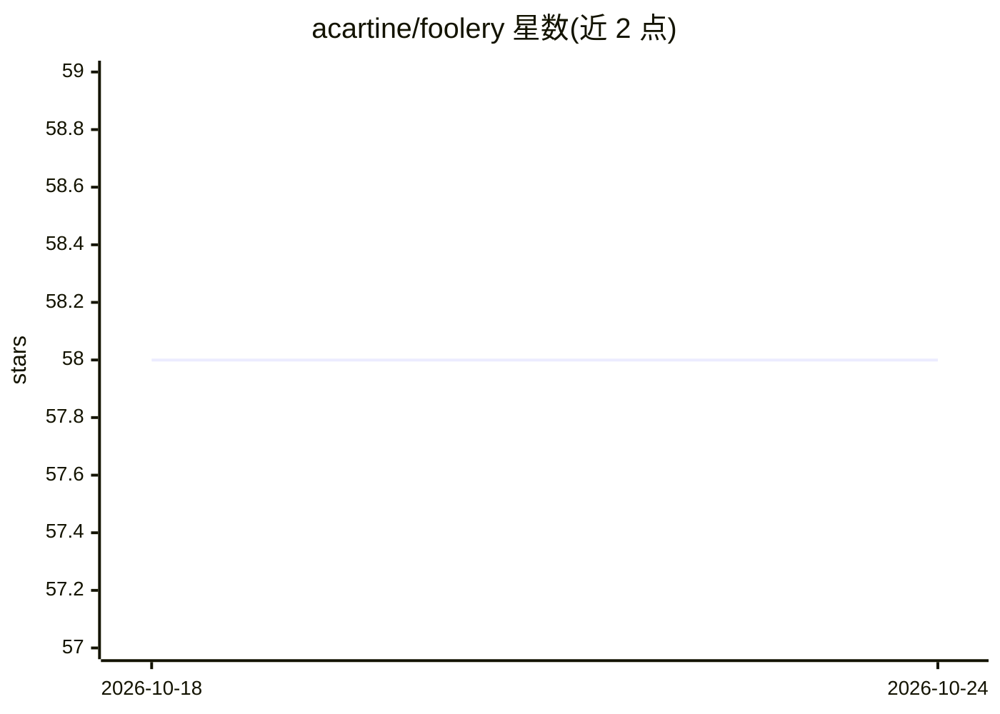

# acartine/foolery

⭐ 58 · TypeScript · MIT · 推送 2026-07-14 · [GitHub](https://github.com/acartine/foolery) · [官网](https://thecartine.substack.com/p/foolery-04?r=1rb8nt&triedRedirect=true) · 个人维护

**键盘优先的多 Agent 软件工作编排 Web UI**

本地运行的 Agent 编排应用，构建在记忆管理后端（主要 Knots，兼容 Beads）之上。用户将工作拆解为 beats，通过已安装的 Agent CLI（Claude Code、Copilot、Codex、OpenCode、Gemini CLI）派发任务，并在 Overview、Queues、Active、Retakes、History 等视图中跨仓库监控与审查执行结果。提供简单与加权池两种派发模式，setup 命令将配置技能交给第一个发现的 Agent CLI 完成。技术栈为 Next.js/React/TypeScript，MIT 许可。

## 筛选速览

| 维度 | 判定 | 备注 |
|---|---|---|
| AI 角色 | `ai-ecosystem` | LLM/agent 周边工具 |
| 许可风险 | `permissive` | MIT |
| 部署形态 | `None` |  |
| 模型依赖 | — | README 未给出锁定关系 |
| 硬件要求 | — | 无带数字的原话,不猜 |
| 安装摩擦 | `low` | 无编译、无系统依赖或容器化 |
| 成熟度 | — | 结构信号不足 |

## 能力要点

- 支持 5 种 Agent CLI 自动检测与按方言适配调用
- 简单派发与按工作流步骤的加权池派发两种模式
- 依赖感知的 Wave/Step 执行计划视图（Setlist）
- Kanban 式跨仓库状态总览与 Retakes 审查通道

## 适用场景

- 跨多个仓库统一排队、运行并审查 Agent 任务
- 对多个模型做 A/B 测试或按步骤混用不同 Agent
- 以键盘操作为主快速导航与批量更新工作项

## 场景标签

`多智能体` `编码 Agent` · 领域:Agent 开发

## 证据(README 行号)

> L54: Foolery is a local orchestration app for agent-driven software work. It sits on top of memory-manager backends — pr
> L109: ## Supported Agent CLIs
> L113: |Agent|CLI Command|Notes|

## 星数曲线

2026-10-18 58 → 2026-10-24 58（+0）

---
*卡片 v1 · prompt 1.4 · 生成 2026-10-24 · 置信度 high · 依据 README sha `c23a617d8594` · [字段定义](../../DATASET.md)*
