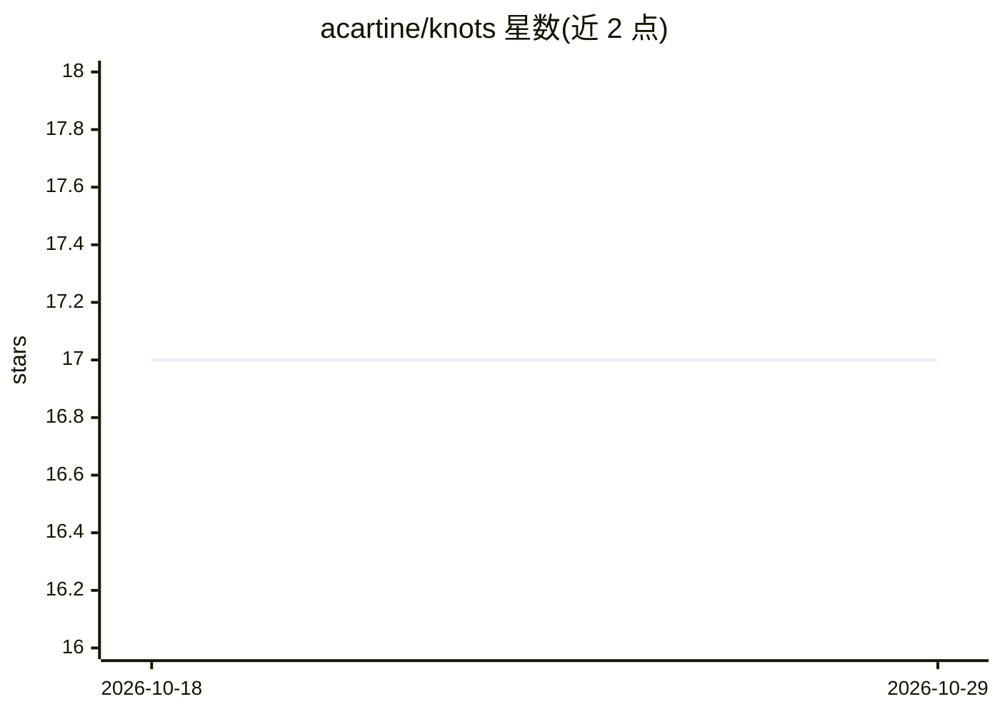

# acartine/knots

⭐ 17 · Rust · MIT · 推送 2026-08-28 · [GitHub](https://github.com/acartine/knots) · [官网](https://thecartine.substack.com/p/oh-knots) · 个人维护

**本地优先、git 同步的人机 agent 工作流协调系统**

Beads 的轻量后继项目：以 append-only 事件加 SQLite 缓存记录工作单元（knot）的状态流转，通过 git 远端分支同步。面向使用编码 agent 的开发者：agent 通过 CLI 标准输出接收自包含提示（poll --claim 原子领取最高优先级任务），以 kno next 推进状态，直至 shipped。提供 lease 机制防止远端同步抢占进行中的任务，支持单步授权（single_action）与端到端续跑（--e2e）两种边界，支持 JSON 输出与执行计划编排。安装通过 GitHub Releases 脚本完成。

## 筛选速览

| 维度 | 判定 | 备注 |
|---|---|---|
| AI 角色 | `ai-ecosystem` | LLM/agent 周边工具 |
| 许可风险 | `permissive` | MIT |
| 部署形态 | `None` |  |
| 模型依赖 | — | README 未给出锁定关系 |
| 硬件要求 | — | 无带数字的原话,不猜 |
| 安装摩擦 | `low` | 无编译、无系统依赖或容器化 |
| 成熟度 | — | 结构信号不足 |

## 能力要点

- append-only 事件 + SQLite 缓存，git 远端分支同步
- poll/claim 作为 agent 主接口，CLI stdout 即提示投递，无需 agent 专属 API
- lease 会话令牌：默认 10 分钟超时，持有期间抑制 pull 防止任务被抢占
- single_action / e2e_continuation 两级 agent 授权边界

## 适用场景

- 让编码 agent 在结构化队列中领取并推进开发任务
- 人机混合工作流中对评审等步骤做人工把关
- 多机器通过 git 分支同步共享工作流状态
- 用 execution_plan 类型编排跨 knot 的并发执行计划

## 场景标签

`工作流自动化` · 领域:效率与自动化

## 证据(README 行号)

> L8: Knots is a local-first, git-backed system for helping humans and agents understand what they did, what they are doin

## 星数曲线

2026-10-18 17 → 2026-10-29 17（+0）

---
*卡片 v1 · prompt 1.4 · 生成 2026-10-29 · 置信度 high · 依据 README sha `a441ab719bb8` · [字段定义](../../DATASET.md)*
