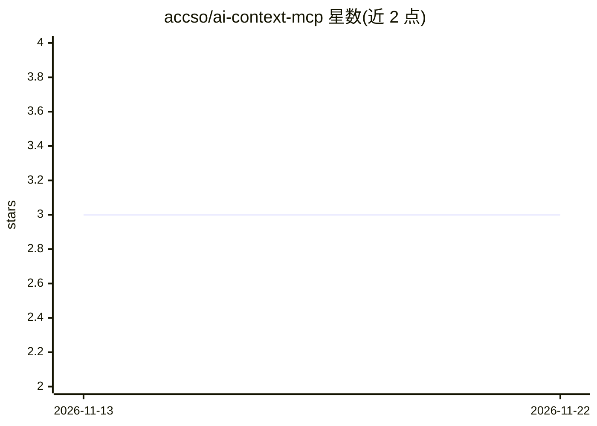

# accso/ai-context-mcp

⭐ — · [GitHub]() · 组织维护

**为 AI 编码代理提供本地私有仓库上下文索引的 MCP 服务器**

本地运行的上下文层：索引代码块、符号、调用/导入图与文档，通过 MCP（StreamableHTTP）向编码代理按查询返回相关上下文，减少整个文件写入上下文窗口。检索路径无 LLM 参与；使用 tree-sitter 符号索引、混合向量检索加 ColBERT 重排、调用图影响分析。嵌入、重排、向量检索与存储（Qdrant、PostgreSQL）全部本地执行；L1 文件摘要依赖配置的本地 LLM 提供方（lmstudio/omlx/ollama）。安装需 Docker、mise、jq、python3，通过 mise 任务启动。

## 筛选速览

| 维度 | 判定 | 备注 |
|---|---|---|
| AI 角色 | `ai-ecosystem` | LLM/agent 周边工具 |
| 许可风险 | `permissive` | — |
| 部署形态 | `self-host` | docker 或自建部署 |
| 模型依赖 | local-ok | 支持本地模型 |
| 硬件要求 | — | 无带数字的原话,不猜 |
| 安装摩擦 | `low` | 无编译、无系统依赖或容器化 |
| 成熟度 | — | 结构信号不足 |

## 能力要点

- 通过 MCP 提供 repo_structure/semantic_search/get_file/analyze_impact/resolve_symbol 五类工具
- tree-sitter 符号索引 + 混合向量检索与 ColBERT 重排 + 调用/导入图影响分析
- 文件监视（2 秒防抖）与 SHA 增量对账保持索引自愈更新
- 嵌入、重排、向量检索与存储全部本地运行，不向外部服务器发送数据

## 适用场景

- 让编码代理只读取与查询相关的代码上下文以节省 token
- 在无法让代码离开本地的环境中为代理提供检索
- 分析调用图的影响范围并定位可能覆盖的测试

## 场景标签

`RAG` `语义搜索` · 领域:知识与检索

## 证据(README 行号)

> L3: Token-efficient, **locally run** context layer for AI coding agents. It indexes your repository (code chunks, symbol
> L5: Works with any MCP client that speaks StreamableHTTP, e.g. GitHub Copilot (VS Code and IntelliJ plugins), JetBrains 

## 星数曲线

2026-11-13 3 → 2026-11-22 3（+0）

---
*卡片 v1 · prompt 1.4 · 生成 2026-11-22 · 置信度 mid · 依据 README sha `c0283904cf8c` · [字段定义](../../DATASET.md)*
