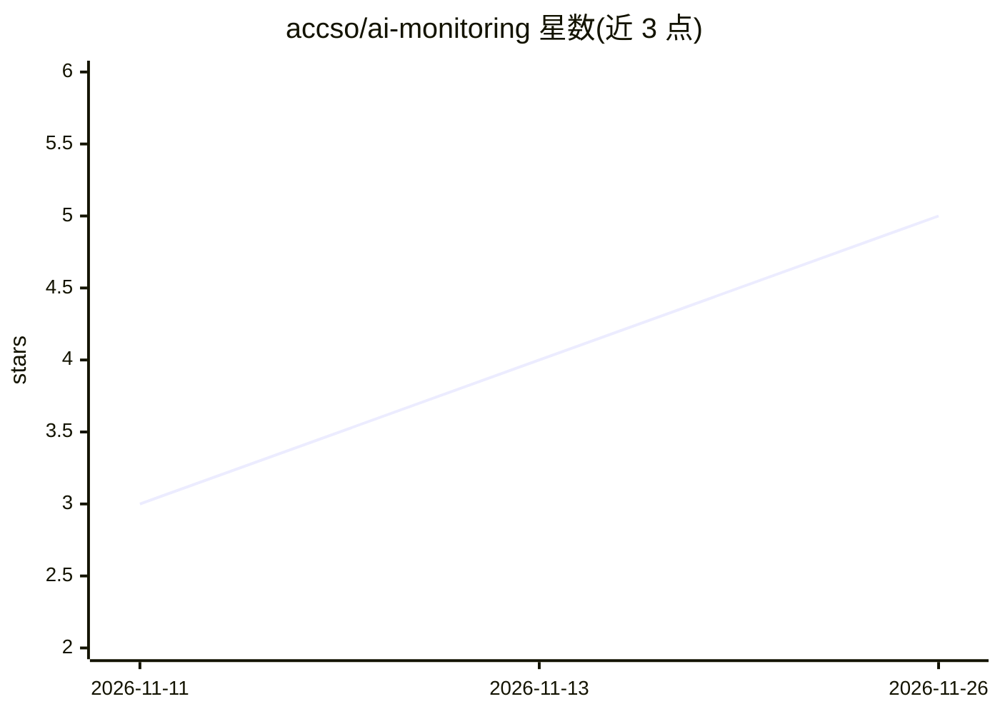

# accso/ai-monitoring

⭐ 5 · TypeScript · Apache-2.0 · 推送 2026-11-17 · [GitHub](https://github.com/accso/ai-monitoring) · 组织维护

**AI 编码 agent 用量监控栈：按项目/模型/提供商追踪 token 与成本**

面向团队监控 AI 编码 agent 使用情况的可观测性栈：通过 OpenCode 插件采集 token、成本、积分等用量数据，经 OTel Collector 汇入 VictoriaMetrics，由 Grafana 展示；可接入任意 OTel GenAI 数据源（如 GitHub Copilot）。文档覆盖架构、指标目录、定价同步、仪表盘与插件配置，通过 docs/getting-started.md 入门，提供 docker-compose 部署方式。由 Accso GmbH 的开发者维护，Apache 2.0 许可。

## 筛选速览

| 维度 | 判定 | 备注 |
|---|---|---|
| AI 角色 | `ai-ecosystem` | LLM/agent 周边工具 |
| 许可风险 | `permissive` | Apache-2.0 |
| 部署形态 | `None` |  |
| 模型依赖 | — | README 未给出锁定关系 |
| 硬件要求 | — | 无带数字的原话,不猜 |
| 安装摩擦 | `low` | 无编译、无系统依赖或容器化 |
| 成熟度 | — | 结构信号不足 |

## 能力要点

- OpenCode 插件采集 token/成本/积分，按项目、模型、提供商维度统计
- OTel Collector → VictoriaMetrics → Grafana 数据链路
- 支持接入任意 OTel GenAI 数据源（如 GitHub Copilot）
- 文档含指标目录、定价同步与仪表盘编辑说明

## 适用场景

- 追踪各项目 AI 编码 agent 的 token 消耗与费用
- 在 Grafana 仪表盘实时查看 AI 用量指标
- 统一接入 Copilot 等 OTel GenAI 数据源做 FinOps 分析

## 场景标签

`LLM 可观测性` · 领域:评测与运维

## 证据(README 行号)

> L3: Live monitoring of AI coding-agent usage (tokens, cost, credits) per project, model and provider: OpenCode plugin → 
> L15: |docs/plugin.md|OpenCode plugin: install, configuration|

## 星数曲线

2026-11-11 3 → 2026-11-26 5（+2）

---
*卡片 v1 · prompt 1.4 · 生成 2026-11-21 · 置信度 mid · 依据 README sha `cae079b956ad` · [字段定义](../../DATASET.md)*
