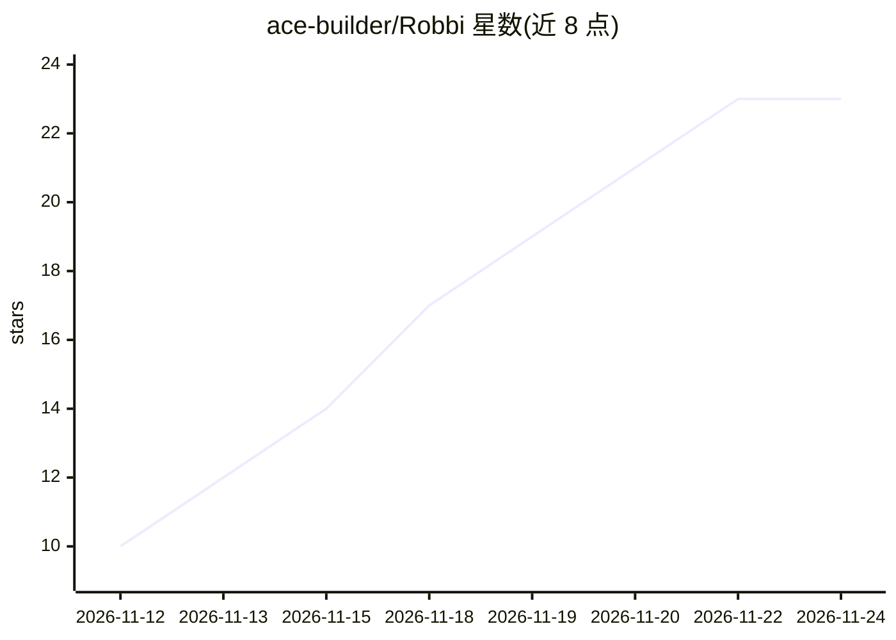

# ace-builder/Robbi

⭐ 23 · Python · 推送 2026-11-06 · [GitHub](https://github.com/ace-builder/Robbi) · [官网](https://youtube.com/@acebuilder-diy) · 个人维护

**DIY 树莓派 AI 桌面伴侣机器人：自带表情脸、摄像头与语音**

面向有经验的创客的开源硬件+软件项目：以 Raspberry Pi Zero 2 W、自制 PCB、N20 编码电机、SPI 表情显示屏、USB 麦克风、扬声器与摄像头为核心，组装出一个有面部、语音交互和移动能力的小型机器人。仓库提供图解硬件搭建指南（零件、3D 打印、PCB 制造、接线、装配与校准）与运行其上的软件，含一键安装脚本、仪表盘、语音 provider 配置。README 明确标注为极早期版本，当前外壳设计仅经 CAD 与切片检查、未做实物验证，并列出供电、运动精度、麦克风降噪等多条已知限制。

## 筛选速览

| 维度 | 判定 | 备注 |
|---|---|---|
| AI 角色 | `ai-native` | 本体是模型或模型工具 |
| 许可风险 | `none` | — |
| 部署形态 | `None` |  |
| 模型依赖 | — | README 未给出锁定关系 |
| 硬件要求 | — | 无带数字的原话,不猜 |
| 安装摩擦 | `low` | 无编译、无系统依赖或容器化 |
| 成熟度 | `idea` | |

## 能力要点

- 树莓派 Zero 2 W + 自制 PCB + 编码电机 + 表情显示屏的完整 DIY 方案
- curl 安装脚本引导安装：校验源码快照、配置运行时与启动服务、设置仪表盘凭据
- 图解硬件搭建指南覆盖零件清单、PCB 原理图、接线和装配校准
- 支持语音 provider 配置与仪表盘

## 适用场景

- 我想从零件开始造一个自己的 AI 桌面机器人
- 创客学习机器人硬件装配、PCB 制作与校准流程
- 给桌面装一个有表情和语音的互动小机器人

## 场景标签

`语音 Agent` · 领域:对话与助手

## 证据(README 行号)

> L1: # Robbi
> L7: A tiny Raspberry Pi robot with a face, a camera, a voice and two encoder-equipped wheels. This repository brings tog
> L14: |Parts, tools, 3D prints, PCB manufacturing, wiring, assembly and calibration.|First installation, dashboard, voice

## 星数曲线

2026-11-12 10 → 2026-11-24 23（+13）

---
*卡片 v1 · prompt 1.4 · 生成 2026-11-18 · 置信度 mid · 依据 README sha `74febc81aa9e` · [字段定义](../../DATASET.md)*
