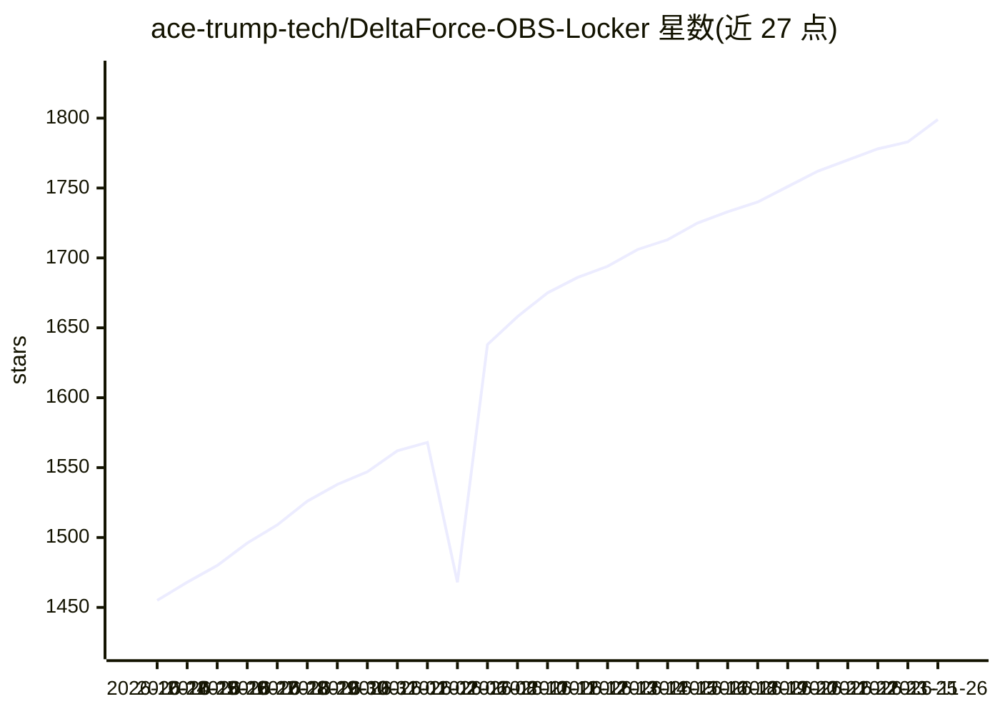

# ace-trump-tech/DeltaForce-OBS-Locker

⭐ 1,799 · Python · 推送 2026-11-04 · [GitHub](https://github.com/ace-trump-tech/DeltaForce-OBS-Locker) · 个人维护 · 中文 README

**面向三角洲行动玩家的 OBS 画面识别与模拟输入工具**

仓库包含电脑端与手机端两个子项目：电脑端为 Python 项目，基于 OpenCV 与 YOLO-omni/YOLOv14 目标检测框架读取 OBS 捕获的游戏画面，识别角色骨骼点，并通过 SendInput 模拟鼠标输入；手机端提供 APK 自动下载脚本。声明不修改游戏内存，依赖需单独下载的 YOLO-omni 预训练权重文件。按赛季（S10/S11）更新地图与外观识别逻辑，README 定位为技术教学与原理验证项目。

## 筛选速览

| 维度 | 判定 | 备注 |
|---|---|---|
| AI 角色 | `ai-native` | 本体是模型或模型工具 |
| 许可风险 | `none` | — |
| 部署形态 | `library` | 以包/库形式分发 |
| 模型依赖 | — | README 未给出锁定关系 |
| 硬件要求 | — | 无带数字的原话,不猜 |
| 安装摩擦 | `low` | 无编译、无系统依赖或容器化 |
| 成熟度 | — | 结构信号不足 |

## 能力要点

- 基于 YOLO-omni/YOLOv14 的游戏画面目标检测与骨骼点识别
- SendInput 模拟输入与多帧投票降噪机制
- 电脑端/手机端两个子项目分别提供独立仓库与安装命令
- 按游戏赛季（S10 核电站AZ3、S11 潮汐监狱）迭代识别隔离逻辑

## 适用场景

- 复现 OBS 画面捕获加目标检测的图像处理流程
- 学习 Python 环境配置、OpenCV 与模拟输入的工程组合
- 在 Android 设备上通过脚本下载 APK 进行测试

## 场景标签

`目标检测` · 领域:感知与多模态

## 证据(README 行号)

> L67: |**电脑端**|Python, OpenCV, YOLO-omni, OBS, SendInput|Python 初学者、计算机视觉爱好者|电脑端 README|
> L109: ## 🧠 YOLO-omni：跨域实时目标检测框架

## 星数曲线

2026-10-24 1,455 → 2026-11-26 1,799（+344）

---
*卡片 v1 · prompt 1.4 · 生成 2026-11-23 · 置信度 high · 依据 README sha `31caf8f60b67` · [字段定义](../../DATASET.md)*
