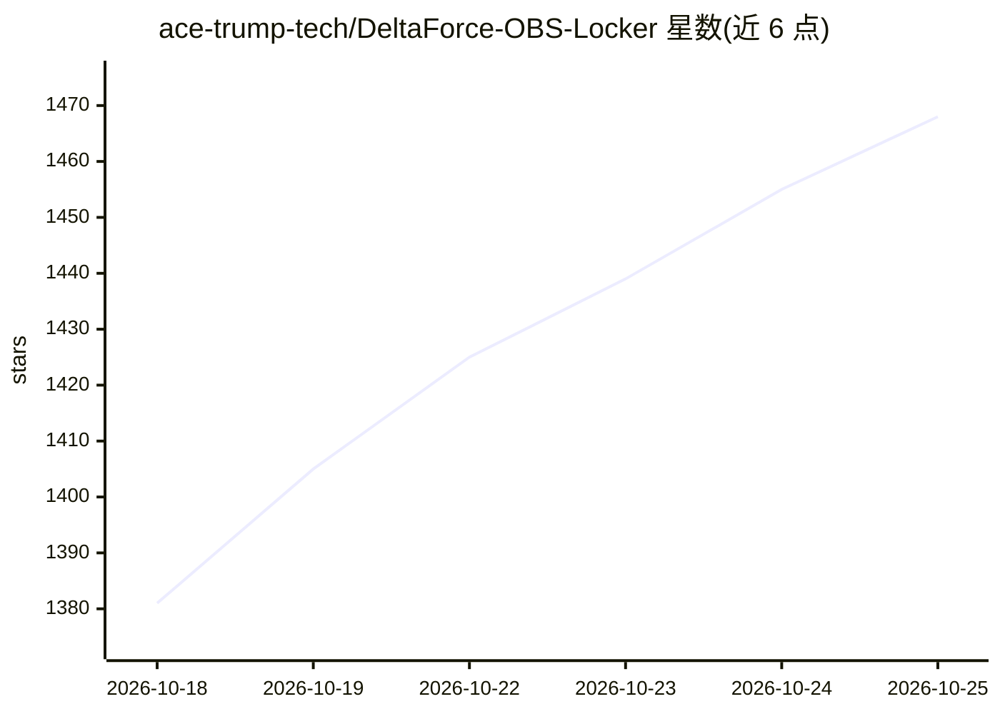

# ace-trump-tech/DeltaForce-OBS-Locker

⭐ 1,468 · Python · 推送 2026-10-24 · [GitHub](https://github.com/ace-trump-tech/DeltaForce-OBS-Locker) · 个人维护 · 中文 README

**游戏《三角洲行动》基于 OBS 画面识别的锁头辅助工具（PC/安卓）**

以 Python + OpenCV + YOLO-omni 实现的游戏目标检测与模拟输入项目：通过 OBS 捕获《三角洲行动》画面，用 YOLOv14/yolo-omni 检测游戏角色并定位，配合 SendInput 模拟鼠标实现画面吸附；含反检测演示（动态路径、多帧投票）与自动钓鱼模块。分电脑端（Python 源码）与手机端（APK 下载脚本）两个子项目，需另行下载模型权重。README 声明仅供技术学习、不建议真实对局使用，许可证禁止商用作弊。

## 筛选速览

| 维度 | 判定 | 备注 |
|---|---|---|
| AI 角色 | `ai-native` | 本体是模型或模型工具 |
| 许可风险 | `none` | — |
| 部署形态 | `library` | 以包/库形式分发 |
| 模型依赖 | — | README 未给出锁定关系 |
| 硬件要求 | — | 无带数字的原话,不猜 |
| 安装摩擦 | `low` | 无编译、无系统依赖或容器化 |
| 成熟度 | — | 结构信号不足 |

## 能力要点

- OBS 画面捕获 + YOLO-omni 游戏角色检测（Game2Real 域适配）
- 反检测演示：动态路径、多帧投票、ACE 4.0 同步
- V5.0.0 新增基于视觉中心+骨骼点定位的自动钓鱼模块
- 电脑端 Python 源码 + 手机端 APK 下载脚本双形态

## 适用场景

- 学习目标检测与模拟输入的工程实践
- 在本地复现 OBS 画面吸附的原理验证
- Android 设备上测试识别原理（APK）

## 场景标签

`目标检测` · 领域:感知与多模态

## 证据(README 行号)

> L46: > ⚠️ **重要提醒**：无论电脑端还是手机端，AI 识别功能都依赖 **YOLO-omni 预训练权重文件**。
> L111: **YOLO-omni** 是专为 **非理想成像条件** 设计的实时目标检测框架。与假设标准针孔相机的传统 YOLO 不同，YOLO-omni 通过学习 **域不变、视角鲁棒** 的特征，在游戏角色检测上表现出色。
> L160: - **电脑端**：基于真实游戏画面的 Python 编程实战项目，涵盖环境配置、图像处理、目标检测、模拟输入、反检测演示等。其中 **OBS 吸附功能正是 YOLOv14 框架的一次具体实践**。

## 星数曲线

2026-10-18 1,381 → 2026-10-25 1,468（+87）

---
*卡片 v1 · prompt 1.4 · 生成 2026-10-21 · 置信度 high · 依据 README sha `23b0f55289b7` · [字段定义](../../DATASET.md)*
