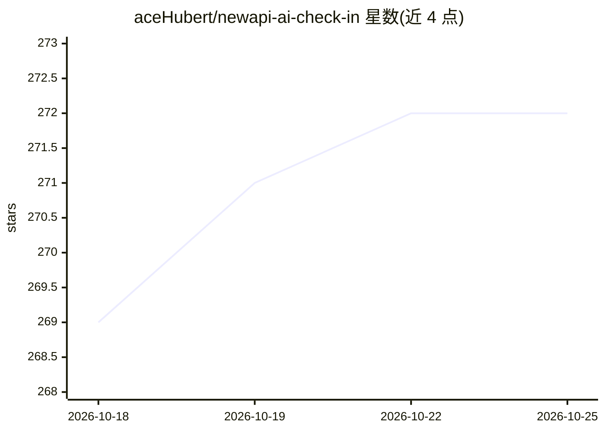

# aceHubert/newapi-ai-check-in

⭐ 272 · Python · BSD-2-Clause · 推送 2026-09-06 · [GitHub](https://github.com/aceHubert/newapi-ai-check-in) · [官网](https://anyrouter.top/register?aff=ZXtq) · 个人维护 · 中文 README

**newapi.ai 站点多账号自动签到脚本，跑在 GitHub Actions**

面向 newapi.ai 类公益 API 站点的自动签到工具：Fork 仓库后通过 GitHub Environment Secrets 配置多账号（支持 linux.do、GitHub OAuth（含 OTP）、站点账号密码、cookies、system_access_token 多种认证方式），由 GitHub Actions 每 8 小时定时执行。内置浏览器模式（browser/auto）可处理验证码与 Cloudflare 防护，支持 http/socks5 代理与自定义 PROVIDERS 扩展站点，签到结果可经邮箱、钉钉、飞书、企业微信、PushPlus、Server酱、Telegram 等渠道通知。附带纯 HTML 的 secret JSON 生成器，本地开发使用 uv。

## 筛选速览

| 维度 | 判定 | 备注 |
|---|---|---|
| AI 角色 | `ai-enhanced` | 去掉 AI 部分产品仍成立 |
| 许可风险 | `permissive` | BSD-2-Clause |
| 部署形态 | `None` |  |
| 模型依赖 | — | README 未给出锁定关系 |
| 硬件要求 | — | 无带数字的原话,不猜 |
| 安装摩擦 | `low` | 无编译、无系统依赖或容器化 |
| 成熟度 | — | 结构信号不足 |

## 能力要点

- 单/多账号定时签到，GitHub Actions 每 8 小时执行
- 支持 linux.do / GitHub(OTP) / 站点账密 / cookies / 系统令牌多种认证
- 浏览器模式处理 Cloudflare bypass 与验证码场景
- 七种通知渠道与 http/socks5 代理支持

## 适用场景

- 我有多个 newapi.ai 类站点账号，想自动完成每日签到
- 通过钉钉/飞书/TG 等机器人接收签到结果通知
- 站点启用验证码防护时用浏览器模式登录签到

## 场景标签

`浏览器自动化` `工作流自动化` · 领域:效率与自动化

## 证据(README 行号)

> L1: # newapi.ai 多账号自动签到
> L3: 用于公益站多账号每日签到。

## 星数曲线

2026-10-18 269 → 2026-10-25 272（+3）

---
*卡片 v1 · prompt 1.4 · 生成 2026-10-22 · 置信度 low · 依据 README sha `f2a92e2ff9b9` · [字段定义](../../DATASET.md)*
