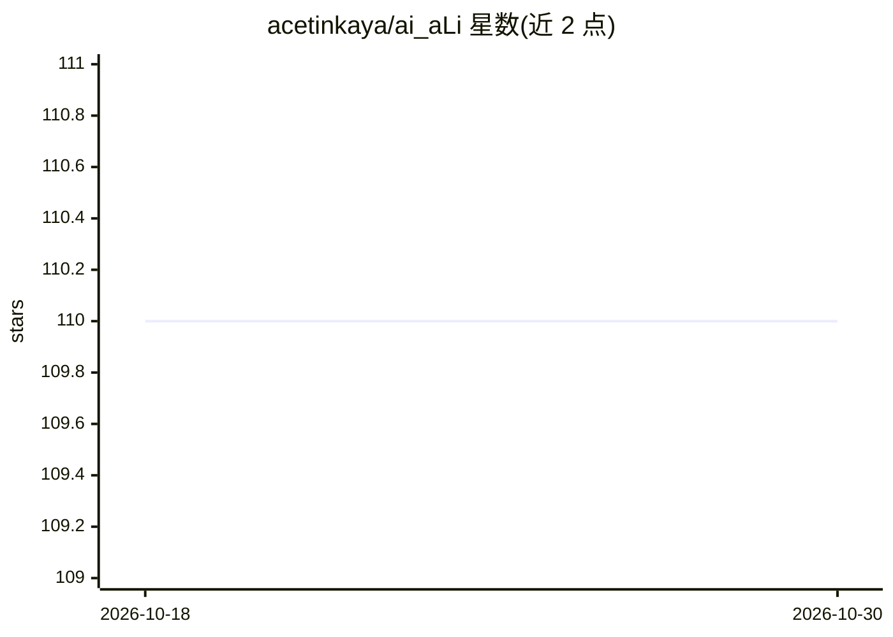

# acetinkaya/ai_aLi

⭐ 110 · Jupyter Notebook · MIT · 推送 2026-08-31 · [GitHub](https://github.com/acetinkaya/ai_aLi) · [官网](https://alicetinkaya.site/ders-yapay-zeka-yz) · 组织维护

**面向土耳其语读者的 AI 教学与参考文献汇编**

由讲师 Ali Çetinkaya（伊斯坦布尔盖利西姆大学）维护的教学性质仓库：围绕人工智能、机器学习、深度学习、模糊逻辑等主题，汇集土耳其学者著作与经典论文的参考文献清单（如 Cahit Arf 1959、Zadeh 模糊集、Turing、BERT、GAN 等 30 余条），并提供 IEEE 与 APA 引用格式说明。README 仅为文献与作者信息，未展示具体可运行的代码内容、安装步骤或使用方法；项目以 MIT 许可发布，接受拉取请求。适合作为 AI 教学参考资料使用。

## 筛选速览

| 维度 | 判定 | 备注 |
|---|---|---|
| AI 角色 | `ai-knowledge` | 知识聚合/清单类 |
| 许可风险 | `permissive` | MIT |
| 部署形态 | `None` |  |
| 模型依赖 | — | README 未给出锁定关系 |
| 硬件要求 | — | 无带数字的原话,不猜 |
| 安装摩擦 | `low` | 无编译、无系统依赖或容器化 |
| 成熟度 | — | 结构信号不足 |

## 能力要点

- 汇编 30 余条 AI 历史与经典论文参考文献
- 覆盖土耳其学者著作与国际经典文献（感知机、模糊集、BERT、GAN 等）
- 提供仓库的 IEEE 与 APA 引用格式说明

## 适用场景

- 查找 AI 教学相关的土耳其语参考书目
- 追溯 AI 历史经典文献的出处
- 为课程或研究引用本仓库内容

## 场景标签

`科研工具` `精选清单` · 领域:学习与行业

## 证据(README 行号)

> L66: Tablo 1 içerisinde yer alan çalışmaların referans kaynak listesi:
> L140: <-- Saygılarımla Öğr. Gör. Ali ÇETİNKAYA - Eylül 2024 -->

## 星数曲线

2026-10-18 110 → 2026-10-30 110（+0）

---
*卡片 v1 · prompt 1.4 · 生成 2026-10-23 · 置信度 mid · 依据 README sha `9d4f3054c0aa` · [字段定义](../../DATASET.md)*
