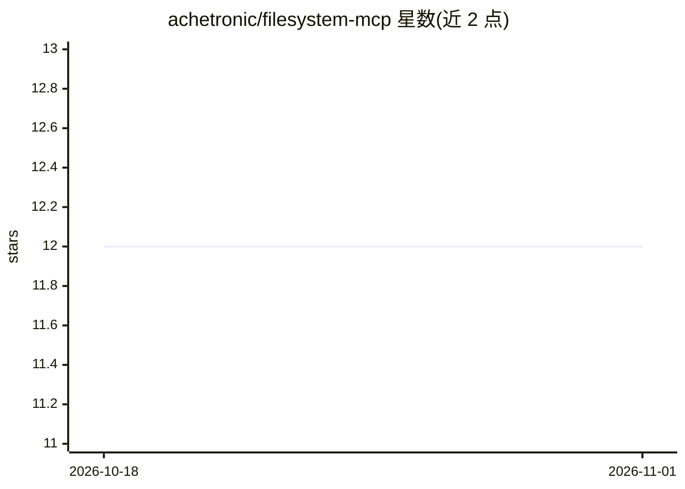

# achetronic/filesystem-mcp

⭐ 12 · Go · Apache-2.0 · 推送 2026-06-30 · [GitHub](https://github.com/achetronic/filesystem-mcp) · [官网](https://magec.dev) · 个人维护

**让 AI agent 读写文件系统与执行命令的 MCP 服务器**

用 Go 编写的 MCP（Model Context Protocol）服务器，向 AI agent 提供 12 个工具：文件读写/编辑/搜索/diff、shell 命令前台后台执行、进程管理、系统信息、撤销与内存键值存储。安全机制包括基于 glob 路径模式与 CEL 表达式的 RBAC、JWT（JWKS）本地校验、OAuth RFC 8414/9728 端点；支持 stdio 本地与 HTTP 远程双传输。需从源码编译（Go 1.24+）或下载 linux/darwin 预编译二进制；官方不推荐 Docker 运行，因其设计目标是控制宿主文件系统。

## 筛选速览

| 维度 | 判定 | 备注 |
|---|---|---|
| AI 角色 | `ai-ecosystem` | LLM/agent 周边工具 |
| 许可风险 | `permissive` | Apache-2.0 |
| 部署形态 | `desktop` | 安装包/桌面程序 |
| 模型依赖 | — | README 未给出锁定关系 |
| 硬件要求 | — | 无带数字的原话,不猜 |
| 安装摩擦 | `low` | 无编译、无系统依赖或容器化 |
| 成熟度 | — | 结构信号不足 |

## 能力要点

- 12 个工具：文件操作、shell 执行、进程管理与 agent 工具
- RBAC 按 glob 路径与操作类别（read/write/exec）授权，默认 deny
- OAuth RFC 8414/9728 合规端点与 JWKS + CEL 的 JWT 校验
- stdio 与 HTTP 双传输，token 友好（部分读取、批量编辑、范围 diff）

## 适用场景

- 让 Claude Desktop/Cursor 等客户端通过 MCP 读写本地文件
- 远程 AI 客户端经 HTTP 安全访问受控文件系统
- 对 agent 可操作路径做细粒度权限管控

## 场景标签

`Agent 框架` · 领域:Agent 开发

## 证据(README 行号)

> L6: A production-ready MCP (Model Context Protocol) server that gives AI agents full control over a filesystem — reading
> L15: - 🚀 **Dual transport** — stdio for local clients, HTTP for remote (Claude Web, OpenAI, etc.)

## 星数曲线

2026-10-18 12 → 2026-11-01 12（+0）

---
*卡片 v1 · prompt 1.4 · 生成 2026-11-01 · 置信度 mid · 依据 README sha `a3e5ca30ee43` · [字段定义](../../DATASET.md)*
