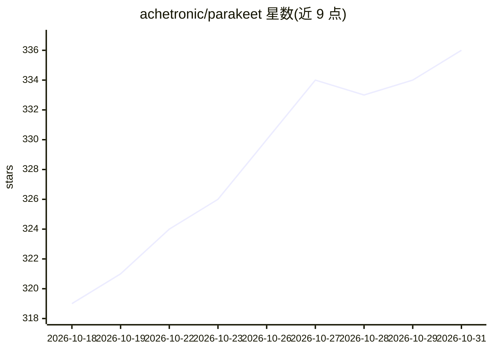

# achetronic/parakeet

⭐ 336 · Go · Apache-2.0 · 推送 2026-07-03 · [GitHub](https://github.com/achetronic/parakeet) · 个人维护

**Go 编写的 Whisper 兼容 ASR 服务器，基于 Parakeet ONNX 模型**

用 Go 实现的语音转文字服务：通过 ONNX Runtime 运行 NVIDIA Parakeet TDT 0.6B 模型（istupakov 转换的 ONNX 版本），对外暴露 OpenAI Whisper 兼容的 REST API，含流式 SSE 转写、API key 认证、JSON/文本/SRT/VTT 多种输出格式，运行时无 Python 依赖。支持 CPU 推理与 CUDA GPU 镜像（linux/amd64），int8 量化模型约需 670MB 磁盘与 2GB 内存；编码器单次上限 400 秒音频，超过需开启 -long-audio 分块转写，边界由 Silero VAD/能量/中点级联决定。提供发布二进制、源码构建与 Docker 镜像三种安装方式。

## 筛选速览

| 维度 | 判定 | 备注 |
|---|---|---|
| AI 角色 | `ai-native` | 本体是模型或模型工具 |
| 许可风险 | `permissive` | Apache-2.0 |
| 部署形态 | `desktop` | 安装包/桌面程序 |
| 模型依赖 | — | README 未给出锁定关系 |
| 硬件要求 | — | 无带数字的原话,不猜 |
| 安装摩擦 | `low` | 无编译、无系统依赖或容器化 |
| 成熟度 | — | 结构信号不足 |

## 能力要点

- OpenAI Whisper 兼容 REST API 与 SSE 流式转写，可作为既有 Whisper 应用的直接替换
- ONNX Runtime 推理，运行时无 Python 依赖（ffmpeg 为可选依赖，仅非 WAV 音频需要）
- 支持 int8 量化模型与 CUDA GPU offload（-cuda 镜像）
- 长音频分块转写：Silero VAD/能量/中点级联选边界并去重接缝 token

## 适用场景

- 为已接入 OpenAI Whisper API 的应用提供本地自托管转写后端
- 在 CPU 或 NVIDIA GPU 服务器上批量转录音频文件
- 需要 SRT/VTT 字幕格式的转写场景

## 场景标签

`语音识别` · 领域:感知与多模态

## 证据(README 行号)

> L2:  A high-performance automatic speech recognition (ASR) server written in Go.
> L3:  It uses NVIDIA's Parakeet TDT 0.6B model through ONNX Runtime to provide speech-to-text transcription via an OpenAI

## 星数曲线

2026-10-18 319 → 2026-10-31 336（+17）

---
*卡片 v1 · prompt 1.4 · 生成 2026-10-21 · 置信度 high · 依据 README sha `12c4a7e5edde` · [字段定义](../../DATASET.md)*
