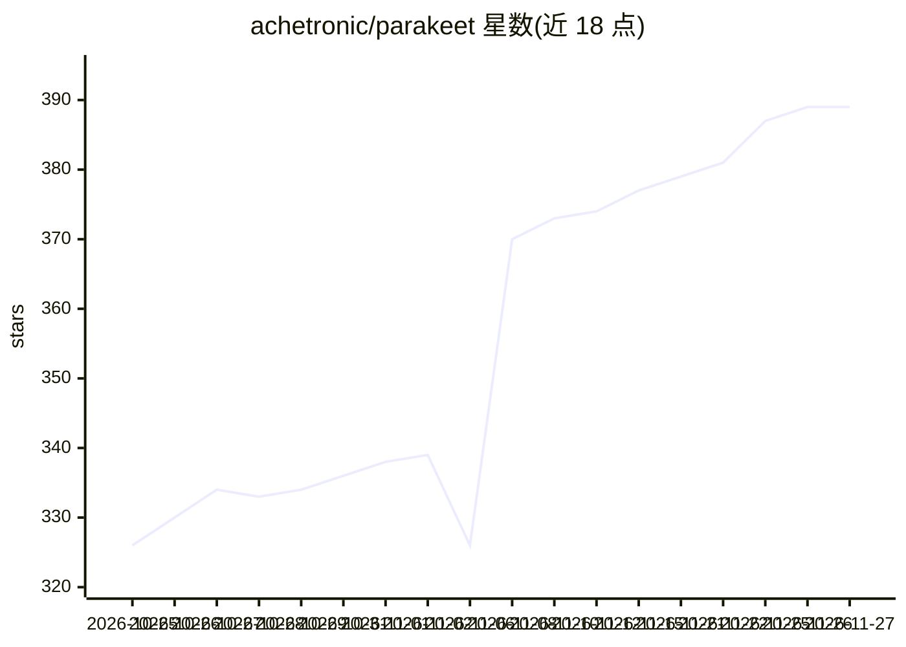

# achetronic/parakeet

⭐ 389 · Go · Apache-2.0 · 推送 2026-11-17 · [GitHub](https://github.com/achetronic/parakeet) · 个人维护

**自托管 ASR 服务器：Whisper 兼容 API 提供 Parakeet 转录**

Go 编写的语音识别服务器，通过 ONNX Runtime 运行 NVIDIA Parakeet TDT 0.6B 模型，暴露与 OpenAI Whisper 兼容的 REST API，供已使用该接口的应用直接替换。支持 SSE 流式转录、JSON/text/SRT/VTT 输出、可选说话人分离、长音频分块与 API key 鉴权；运行时无 Python 依赖，提供二进制、源码与 Docker 三种安装方式，可在 CPU 或可选 CUDA GPU 上推理。

## 筛选速览

| 维度 | 判定 | 备注 |
|---|---|---|
| AI 角色 | `ai-native` | 本体是模型或模型工具 |
| 许可风险 | `permissive` | Apache-2.0 |
| 部署形态 | `self-host` | docker 或自建部署 |
| 模型依赖 | — | README 未给出锁定关系 |
| 硬件要求 | — | 无带数字的原话,不猜 |
| 安装摩擦 | `low` | 无编译、无系统依赖或容器化 |
| 成熟度 | — | 结构信号不足 |

## 能力要点

- OpenAI Whisper 兼容 REST API 与 SSE 流式转录
- ONNX Runtime 推理，支持 CPU 与可选 CUDA GPU，运行时无 Python 依赖
- 输出格式含 JSON/text/SRT/VTT，可选说话人分离
- 长音频分块：Silero VAD/mel 能量/中点三级切分层

## 适用场景

- 为已用 Whisper API 的应用接入本地 ASR 后端
- 自托管生产环境语音转文字服务
- 生成带时间戳的 SRT/VTT 字幕
- CPU 或 NVIDIA GPU 环境下的音频转录

## 场景标签

`语音识别` · 领域:感知与多模态

## 证据(README 行号)

> L2:  A high-performance automatic speech recognition (ASR) server written in Go.
> L3:  It uses NVIDIA's Parakeet TDT 0.6B model through ONNX Runtime to provide speech-to-text transcription via an OpenAI
> L16: - ONNX Runtime inference (CPU and optional CUDA GPU)

## 星数曲线

2026-10-25 326 → 2026-11-27 389（+63）

---
*卡片 v1 · prompt 1.4 · 生成 2026-11-25 · 置信度 high · 依据 README sha `02530228c61c` · [字段定义](../../DATASET.md)*
