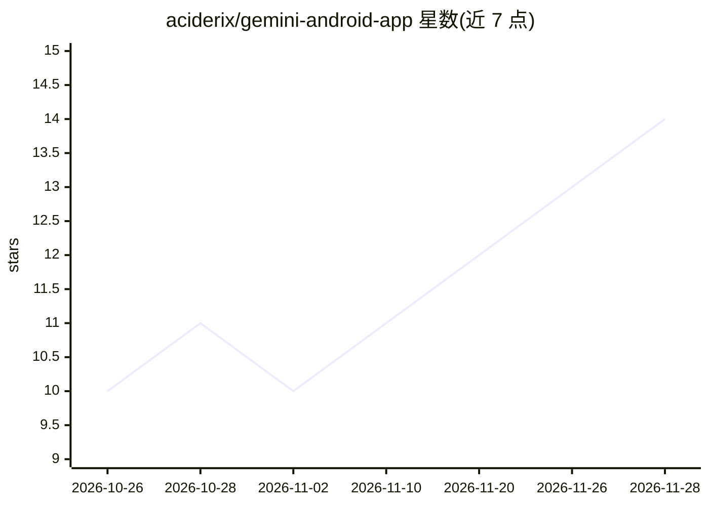

# aciderix/gemini-android-app

⭐ 14 · Kotlin · Apache-2.0 · 推送 2026-04-22 · [GitHub](https://github.com/aciderix/gemini-android-app) · [官网](https://github.com/aciderix/gemini-android-app/releases/latest) · 个人维护

**Android 原生 Gemini 编程客户端：手机上读写文件跑命令**

用 Kotlin + Jetpack Compose 编写的 Android 原生应用，直连 generativelanguage.googleapis.com，API key 经 EncryptedSharedPreferences 本地加密，无中间服务器。模型通过 9 个内置函数工具读取/写入/编辑文件、经 Termux 执行 shell 命令（编译、测试、启动服务器），破坏性操作前弹出审批对话框。支持流式对话、图片输入分析、Imagen 与 Gemini 2.5 Flash Image 生成图片、上下文满时自动压缩会话、逐轮自动保存与 Markdown 导出。需 Android 8.0+ 与 Gemini API key；图片生成需绑定计费。

## 筛选速览

| 维度 | 判定 | 备注 |
|---|---|---|
| AI 角色 | `ai-native` | 本体是模型或模型工具 |
| 许可风险 | `permissive` | Apache-2.0 |
| 部署形态 | `desktop` | 安装包/桌面程序 |
| 模型依赖 | — | README 未给出锁定关系 |
| 硬件要求 | — | 无带数字的原话,不猜 |
| 安装摩擦 | `medium` | 含编译或系统依赖之一 |
| 成熟度 | — | 结构信号不足 |

## 能力要点

- 函数调用 9 个内置工具：文件读写、glob/grep、shell、生成图片
- Termux 桥接执行 shell 命令，支持后台进程
- 上下文用量达阈值（默认 70%）自动压缩会话
- 破坏性工具操作的审批对话框与 diff 展示，可切换自动批准

## 适用场景

- 在手机上让模型直接修改工作区里的项目文件
- 对话中运行 python/npm/cargo 等命令做编译和测试
- 多模态输入：发图片让模型 OCR、描述或推理
- 长时间会话跨天恢复，快照归档与 Markdown 导出

## 场景标签

`AI 助手` `编码 Agent` `图像生成` · 领域:编码与开发

## 证据(README 行号)

> L11: A **native Gemini coding client for Android** — not a wrapper around the
> L52: - **Function calling** with 9 built-in tools:
> L49: - **Streaming chat** over `generativelanguage.googleapis.com`. API key

## 星数曲线

2026-10-26 10 → 2026-11-28 14（+4）

---
*卡片 v1 · prompt 1.4 · 生成 2026-11-18 · 置信度 mid · 依据 README sha `da4b200d3d54` · [字段定义](../../DATASET.md)*
