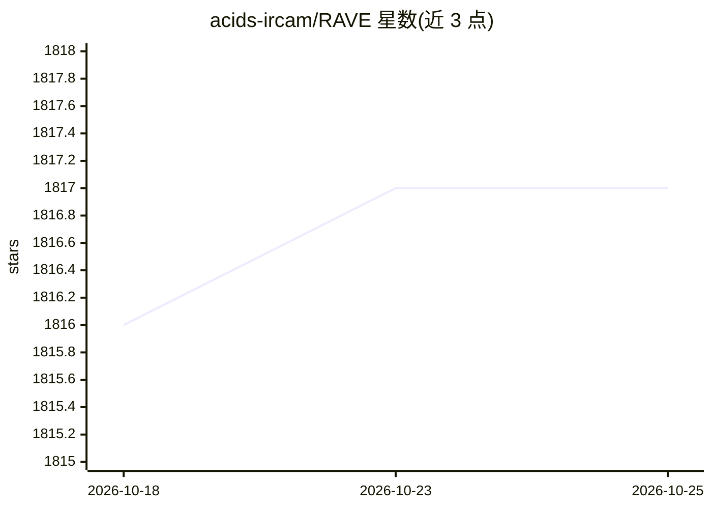

# acids-ircam/RAVE

⭐ 1,818 · Python · NOASSERTION · 推送 2026-03-07 · [GitHub](https://github.com/acids-ircam/RAVE) · 组织维护

**实时神经音频变分自编码器：训练/导出自定义音频生成模型**

RAVE 模型的官方实现，供音频/音乐研究者与创作者在自有音频数据上训练神经合成模型。流程分数据集预处理、训练、导出三步，均通过 rave 命令行执行；提供 v1/v2/v3、离散（类似 SoundStream/EnCodec）、onnx、raspberry 等多种配置及数据增强选项，不同配置标注最低 GPU 显存需求。模型可导出为 torchscript（含流式缓存卷积），经 nn~ 在 Max/MSP 或 PureData 中实时用于重建、隐变量操控与风格迁移，也可离线批量生成；另支持为离散模型训练 prior。IRCAM 团队维护，附 VST beta 与 Colab 训练笔记本。

## 筛选速览

| 维度 | 判定 | 备注 |
|---|---|---|
| AI 角色 | `ai-native` | 本体是模型或模型工具 |
| 许可风险 | `none` | NOASSERTION |
| 部署形态 | `library` | 以包/库形式分发 |
| 模型依赖 | — | README 未给出锁定关系 |
| 硬件要求 | `gpu-8g` | |
| 安装摩擦 | `medium` | 含编译或系统依赖之一 |
| 成熟度 | `idea` | |

## 能力要点

- CLI 覆盖 preprocess/train/export/generate 完整流程
- 多种架构配置（v2/v3/discrete/onnx/raspberry 等）与数据增强
- --streaming 导出缓存卷积实现实时处理，经 nn~ 接入 Max/MSP 与 PureData
- 隐变量操控与基于 Adaptive Instance Normalization 的风格迁移

## 适用场景

- 在自己的音频数据上训练神经合成模型
- 在 Max/MSP 或 PureData 中做实时音色重建与风格迁移
- 离线批量转换大量音频文件
- 在树莓派 4 等嵌入式平台做实时推理

## 场景标签

`模型训练` · 领域:训练与推理

## 证据(README 行号)

> L5: Official implementation of _RAVE: A variational autoencoder for fast and high-quality neural audio synthesis_ (artic
> L51: Training a RAVE model usually involves 3 separate steps, namely _dataset preparation_, _training_ and _export_.
> L194: A pretrained RAVE model named `darbouka.gin` available on your computer can be loaded inside `nn~` using the follo

## 星数曲线

2026-10-18 1,816 → 2026-10-25 1,817（+1）

---
*卡片 v1 · prompt 1.4 · 生成 2026-10-21 · 置信度 high · 依据 README sha `b983345c47a5` · [字段定义](../../DATASET.md)*
