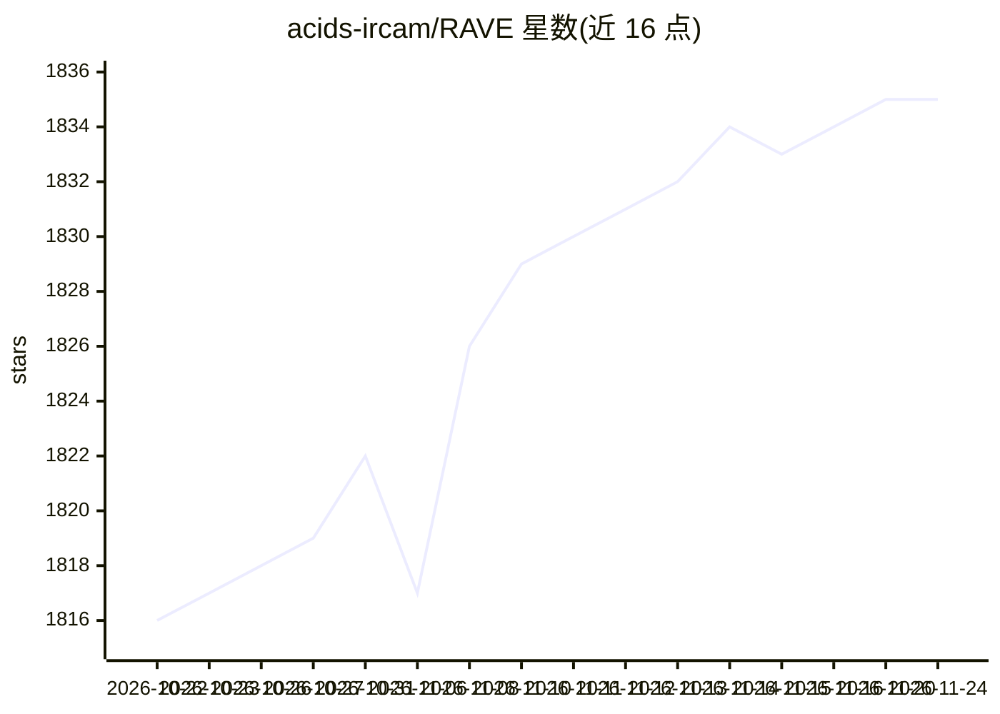

# acids-ircam/RAVE

⭐ 1,836 · Python · NOASSERTION · 推送 2026-11-19 · [GitHub](https://github.com/acids-ircam/RAVE) · 组织维护

**音乐人与研究者的实时神经音频合成变分自编码器**

RAVE（Realtime Audio Variational autoEncoder）的官方实现，由 IRCAM 的 Antoine Caillon 与 Philippe Esling 发布。提供命令行工具完成音频数据预处理、模型训练、微调、导出（.ts/torchscript）与离线生成，支持多种架构配置（v1-v4、discrete、raspberry 等）与数据增强。导出的流式模型可在 nn~、VST 或 Max 8 中实时运行，也可在 Google Colab 上免本地 GPU 训练。当前为 v2.4 beta，API 可能变动。

## 筛选速览

| 维度 | 判定 | 备注 |
|---|---|---|
| AI 角色 | `ai-native` | 本体是模型或模型工具 |
| 许可风险 | `none` | NOASSERTION |
| 部署形态 | `library` | 以包/库形式分发 |
| 模型依赖 | — | README 未给出锁定关系 |
| 硬件要求 | `gpu-8g` | |
| 安装摩擦 | `medium` | 含编译或系统依赖之一 |
| 成熟度 | `idea` | |

## 能力要点

- 支持训练→微调→导出→离线生成的完整命令行流程
- 多种架构配置可选（含树莓派 4 实时推理的轻量配置）
- 导出 --streaming 模型后可在 nn~/VST/Max 中实时处理
- 提供 Windows/Mac/Linux 的 RAVE VST 与 Colab 免费训练笔记本

## 适用场景

- 用自己的音频数据训练神经合成模型并在 DAW 中实时演奏
- 在 Max 8 中对音频做实时音色转换
- 在 Google Colab 免费账号上训练和微调模型
- 在树莓派 4 上部署轻量音频模型

## 场景标签

`微调` `模型训练` · 领域:训练与推理

## 证据(README 行号)

> L5: # RAVE: Realtime Audio Variational autoEncoder
> L65: Training a RAVE model usually involves 3 separate steps, namely _dataset preparation_, _training_ and _export_. All
> L97: rave train --name give_a_name --db_path /processed/path --out_path /model/out --device cuda:0

## 星数曲线

2026-10-22 1,816 → 2026-11-24 1,835（+19）

---
*卡片 v1 · prompt 1.4 · 生成 2026-11-23 · 置信度 high · 依据 README sha `d87c25f51953` · [字段定义](../../DATASET.md)*
