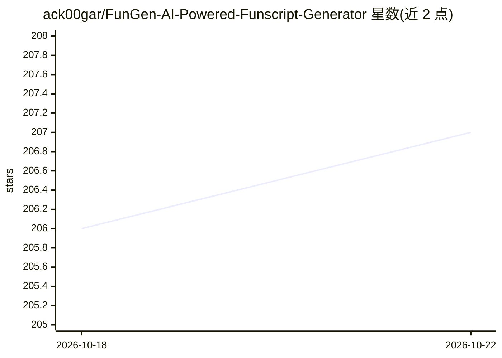

# ack00gar/FunGen-AI-Powered-Funscript-Generator

⭐ 207 · Python · NOASSERTION · 推送 2026-09-09 · [GitHub](https://github.com/ack00gar/FunGen-AI-Powered-Funscript-Generator) · [官网](https://fungen.app) · 个人维护

**用本地 AI 从 2D/VR 视频生成 funscript 的工具（旧版存档）**

FunGen 从 2D 与 VR 视频（含鱼眼、球面投影、左右/上下格式，最高 8K）在本地 GPU 上用 AI 生成 funscript，全程本机运行、不上传；同时提供逐帧多轴（stroke/surge/sway/twist/roll/pitch）编辑器与播放器，可直接驱动 The Handy、OSR2/SR6 等 Buttplug.io / Intiface 设备。本仓库为 Python 实现的 FunGen 1 存档，已停止开发；现行版本 FunGen 2 为独立原生二进制，见 fungen.app。许可为仅限个人非商业使用。

## 筛选速览

| 维度 | 判定 | 备注 |
|---|---|---|
| AI 角色 | `ai-native` | 本体是模型或模型工具 |
| 许可风险 | `none` | NOASSERTION |
| 部署形态 | `None` |  |
| 模型依赖 | — | README 未给出锁定关系 |
| 硬件要求 | — | 无带数字的原话,不猜 |
| 安装摩擦 | `low` | 无编译、无系统依赖或容器化 |
| 成熟度 | — | 结构信号不足 |

## 能力要点

- 本地 GPU 上对 2D/VR 视频做 AI funscript 生成，不上传数据
- 逐帧多轴 funscript 编辑器与播放器（六轴同一时间线）
- 支持 The Handy、OSR2/SR6、Autoblow 及 Buttplug.io / Intiface 设备

## 适用场景

- 从 2D 或 VR 视频自动生成 funscript 脚本
- 手工编辑或清理 AI 生成的多轴脚本并直接播放到设备
- 查阅 FunGen 1 的历史实现与版本记录（v0.6.0–v1.0.0）

## 场景标签

`图像视频处理` · 领域:感知与多模态

## 证据(README 行号)

> L8: FunGen generates funscripts from 2D and VR video with AI, entirely on your own
> L26: - **Runs entirely on your own machine**: AI generation is local, nothing is

## 星数曲线

2026-10-18 206 → 2026-10-22 207（+1）

---
*卡片 v1 · prompt 1.4 · 生成 2026-10-22 · 置信度 high · 依据 README sha `f180f631ffc9` · [字段定义](../../DATASET.md)*
