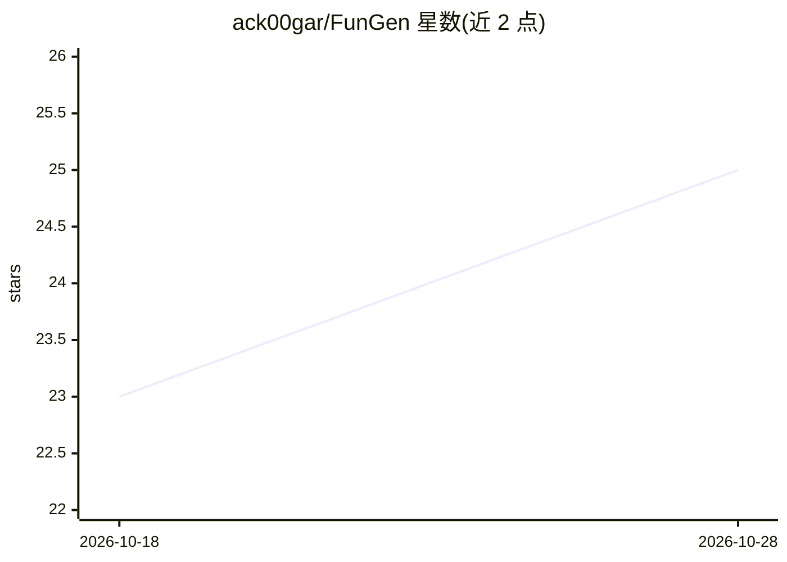

# ack00gar/FunGen

⭐ 25 · NOASSERTION · 推送 2026-10-24 · [GitHub](https://github.com/ack00gar/FunGen) · [官网](https://fungen.app) · 个人维护

**本地运行的 funscript 编辑器与 AI 生成器，支持设备直连播放**

面向 funscript 制作用户的跨平台桌面应用：单文件原生二进制，含逐帧时间线编辑器、多轴脚本（stroke/surge/sway 等）、脚本质量检查（Funscript Doctor）、章节/书签/热力图与内置播放器。AI 生成提供四种途径（playhead 续写、全自动跟踪管线、实时录制、快速生成），免费档含算法生成与限时 AI 生成，Pro Pass 付费解锁高质量 2D/VR 模型。设备输出支持 The Handy、OSR2/SR6 等多种硬件及 Buttplug.io/Intiface 扩展。许可为个人非商业使用免费。

## 筛选速览

| 维度 | 判定 | 备注 |
|---|---|---|
| AI 角色 | `ai-native` | 本体是模型或模型工具 |
| 许可风险 | `none` | NOASSERTION |
| 部署形态 | `desktop` | 安装包/桌面程序 |
| 模型依赖 | — | README 未给出锁定关系 |
| 硬件要求 | — | 无带数字的原话,不猜 |
| 安装摩擦 | `low` | 无编译、无系统依赖或容器化 |
| 成熟度 | — | 结构信号不足 |

## 能力要点

- 单文件原生二进制，Windows/macOS/Linux 三平台，无需 Python 运行时
- AI 全自动跟踪管线与 20 秒 ghost 预览续写（可先试用后付费）
- 多轴脚本编辑、脚本质量评分与一键修复
- 支持 The Handy、OSR2/SR6 等多种设备及 Buttplug.io/Intiface 接入

## 适用场景

- 把 2D 或 VR 视频一键转为 funscript 草稿再手工精修
- 在多轴时间线上逐帧编辑与对比脚本
- 将脚本直接播放输出到 The Handy 等设备

## 场景标签

 · 领域:成人内容工具/视频动作生成

## 证据(README 行号)

> L3: **Funscript editor and AI generator, running on your own machine.** Turn any 2D or VR video into a funscript, refine
> L26: - **Full auto-generation.** Run the AI tracking pipeline over the whole video.

## 星数曲线

2026-10-18 23 → 2026-10-28 25（+2）

---
*卡片 v1 · prompt 1.4 · 生成 2026-10-27 · 置信度 high · 依据 README sha `50f4ab7a241e` · [字段定义](../../DATASET.md)*
