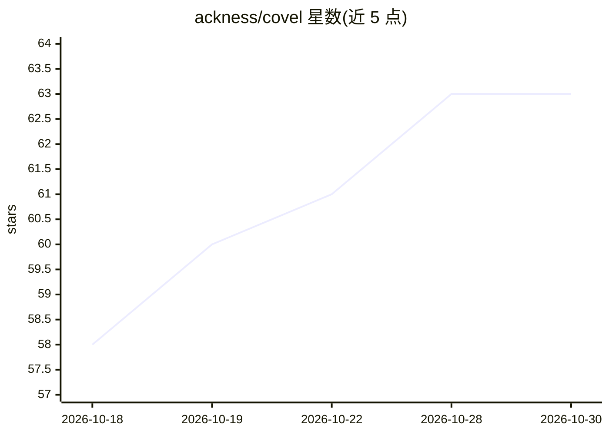

# ackness/covel

⭐ 63 · TypeScript · MIT · 推送 2026-10-29 · [GitHub](https://github.com/ackness/covel) · [官网](https://covel.cc/) · 个人维护 · 中文 README

**模块化 Agentic AI 角色扮演游戏框架与可玩工作室**

Covel 是一个 AI RPG 框架兼可玩工作室，供玩家进行交互式叙事、也供创作者用插件与世界包搭建设定。架构分三层：内核提供原语与编排，插件提供行为（LLM agent、确定性函数、UI、数据契约等），世界包打包设定、资源与默认插件组合。内置骰子检定、任务日志、物品栏、NPC 好感度等 RPG 机制，支持 Stage 视觉小说模式与文本叙事模式。模型槽位支持 OpenAI/Anthropic/DeepSeek/Qwen，本地优先用 SQLite 存储。v0.0.52 为早期访问版本，二进制仅覆盖 macOS Apple Silicon 与 Windows x64 且未签名，API 与数据格式在版本间可能变更。

## 筛选速览

| 维度 | 判定 | 备注 |
|---|---|---|
| AI 角色 | `ai-native` | 本体是模型或模型工具 |
| 许可风险 | `permissive` | MIT |
| 部署形态 | `library` | 以包/库形式分发 |
| 模型依赖 | locked-api |  |
| 硬件要求 | — | 无带数字的原话,不猜 |
| 安装摩擦 | `low` | 无编译、无系统依赖或容器化 |
| 成熟度 | `idea` | |

## 能力要点

- 内核/插件/世界包三层架构，插件可替换、世界包可移植
- Stage 视觉小说模式（场景背景、立绘、打字机对话）与文本叙事模式
- OpenAI/Anthropic/DeepSeek/Qwen 模型槽位，本地优先 SQLite 存储
- 内置骰子检定、任务日志、物品栏、NPC 好感度等 RPG 机制插件

## 适用场景

- 玩 AI 驱动的交互式叙事/视觉小说 RPG
- 用插件组合与世界包创作自定义 AI RPG 设定
- 应用内 AI 世界构建器从创意简报生成完整世界包

## 场景标签

`Agent 框架` · 领域:Agent 开发

## 证据(README 行号)

> L16: Covel is an AI RPG framework and playable studio where NPC relationships, lore, quests, inventory, memory, stage di
> L30: - 🔌 **Bring your own model** — OpenAI / Anthropic / DeepSeek / Qwen model slots. Local-first: SQLite on disk; Web m

## 星数曲线

2026-10-18 58 → 2026-10-30 63（+5）

---
*卡片 v1 · prompt 1.4 · 生成 2026-10-24 · 置信度 high · 依据 README sha `e9b346f2f6d1` · [字段定义](../../DATASET.md)*
