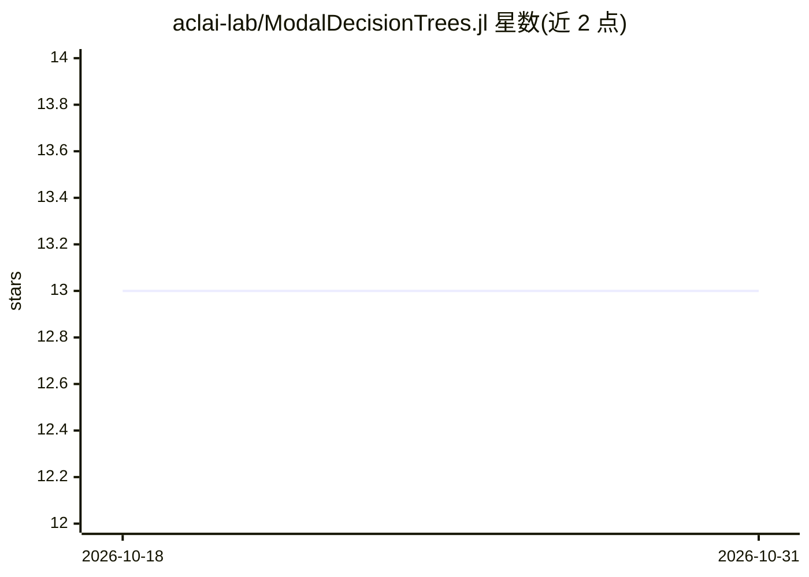

# aclai-lab/ModalDecisionTrees.jl

⭐ 13 · Julia · NOASSERTION · 推送 2026-07-29 · [GitHub](https://github.com/aclai-lab/ModalDecisionTrees.jl) · 组织维护

**Julia 模态决策树/森林库：可解释的时间序列与图像分类**

基于模态逻辑的决策树与随机森林实现，以 Julia 包形式提供，可原生处理时间序列与图像（无需数据预处理），支持多模态学习（标量、时间序列、图像组合），算法扩展自 CART 与 C4.5。通过 MLJ.jl 与 Sole.jl 框架使用，可作为 DecisionTree.jl 树/森林模型的替代品，支持分类与回归。限制：仅支持数值特征，不支持 missing 或 NaN 值。由费拉拉大学 ACLAI Lab 开发。

## 筛选速览

| 维度 | 判定 | 备注 |
|---|---|---|
| AI 角色 | `ai-native` | 本体是模型或模型工具 |
| 许可风险 | `none` | NOASSERTION |
| 部署形态 | `None` |  |
| 模型依赖 | — | README 未给出锁定关系 |
| 硬件要求 | — | 无带数字的原话,不猜 |
| 安装摩擦 | `low` | 无编译、无系统依赖或容器化 |
| 成熟度 | — | 结构信号不足 |

## 能力要点

- 原生处理时间序列与图像，无需预处理
- 支持多模态学习（标量/时间序列/图像组合）
- 扩展 CART 与 C4.5 的模态逻辑算法
- MLJ 接口下可作为 DecisionTree.jl 树/森林的替代品

## 适用场景

- 我要对时间序列或图像做可解释的分类
- 需要可解读规则而非神经网络的分类模型
- 组合标量、时间序列与图像做多模态学习

## 场景标签

 · 领域:机器学习/可解释模型

## 证据(README 行号)

> L11: This package provides algorithms for learning *decision trees* and *decision forests* with enhanced abilities.
> L12: Leveraging the express power of Modal Logic, these models can extract *temporal/spatial patterns*, and can natively

## 星数曲线

2026-10-18 13 → 2026-10-31 13（+0）

---
*卡片 v1 · prompt 1.4 · 生成 2026-10-31 · 置信度 high · 依据 README sha `3cd97bd61949` · [字段定义](../../DATASET.md)*
