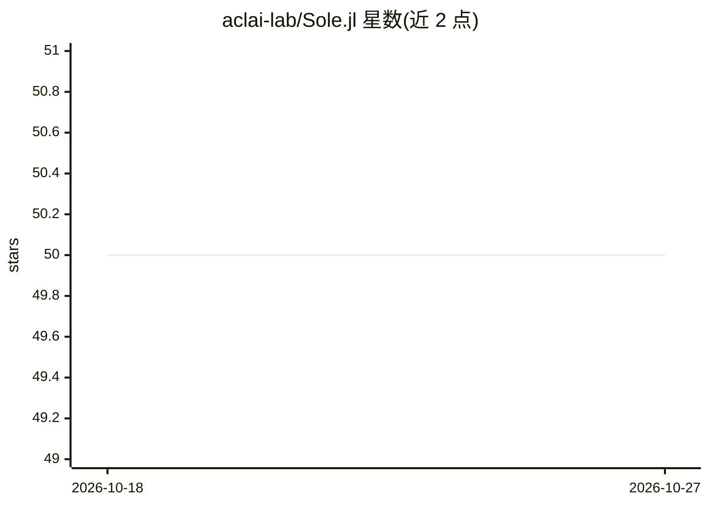

# aclai-lab/Sole.jl

⭐ 50 · Julia · MIT · 推送 2026-01-07 · [GitHub](https://github.com/aclai-lab/Sole.jl) · 组织维护

**Julia 符号机器学习框架：可解释的逻辑建模工具集**

由费拉拉大学 ACLAI Lab 维护的 Julia 包集合，围绕符号学习与推理组织：SoleLogics.jl 提供命题/（多）模态逻辑、公式生成与模型检查的计算逻辑层；SoleData.jl 提供 logiset 数据结构与多模态数据支持；SoleModels.jl 定义决策规则/列表/树/森林等符号模型，支持从 DecisionTree.jl 和 XGBoost.jl 转换，并支持神经符号混合计算。另有模态关联规则挖掘、基于时序/空间逻辑的决策树与决策列表等扩展包。可用于检查、修改与合并已训练决策树。框架自述处于早期（embryonic）阶段。

## 筛选速览

| 维度 | 判定 | 备注 |
|---|---|---|
| AI 角色 | `ai-native` | 本体是模型或模型工具 |
| 许可风险 | `permissive` | MIT |
| 部署形态 | `None` |  |
| 模型依赖 | — | README 未给出锁定关系 |
| 硬件要求 | — | 无带数字的原话,不猜 |
| 安装摩擦 | `low` | 无编译、无系统依赖或容器化 |
| 成熟度 | `idea` | |

## 能力要点

- 命题与（多）模态逻辑层，含公式随机生成、解析、最小化与模型检查
- 符号模型（决策规则/列表/树/森林）定义与规则提取、评估算法
- 从 DecisionTree.jl 与 XGBoost.jl 转换模型并以逻辑公式检查知识
- 支持混合神经符号计算与时序/空间逻辑决策树

## 适用场景

- 把已训练的决策树转换为逻辑公式，检查其可解释性
- 在时序数据上学习基于时序逻辑的决策树
- 挖掘数据中的（模态）关联规则

## 场景标签

 · 领域:机器学习框架/可解释 AI

## 证据(README 行号)

> L2: #### A framework for symbolic, transparent, and interpretable machine learning!
> L37: Although at an embryonic stage, *Sole.jl* covers a range of functionality that is of interest for the symbolic comm
> L93: The package is developed and maintained by the ACLAI Lab @ University of Ferrara.

## 星数曲线

2026-10-18 50 → 2026-10-27 50（+0）

---
*卡片 v1 · prompt 1.4 · 生成 2026-10-24 · 置信度 high · 依据 README sha `24cfbade6d11` · [字段定义](../../DATASET.md)*
