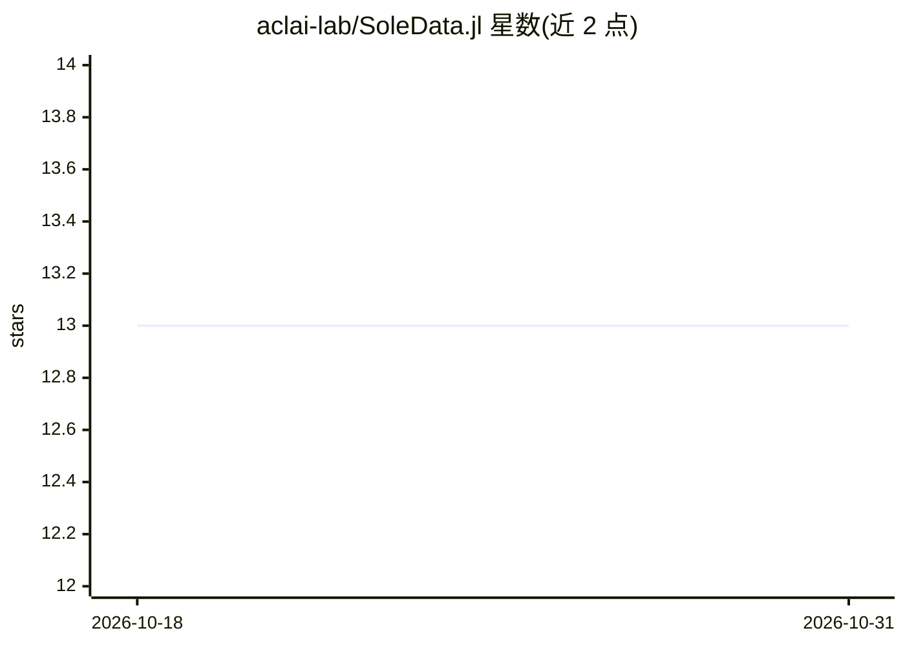

# aclai-lab/SoleData.jl

⭐ 13 · Julia · MIT · 推送 2026-09-03 · [GitHub](https://github.com/aclai-lab/SoleData.jl) · 组织维护

**符号 AI 的逻辑数据集结构库，供逻辑模型反复检验**

Julia 包，提供 logiset（逻辑解释的集合）数据结构，作为机器学习数据集的符号对应物，针对多次模型检验场景做优化。支持将表格数据（如 Iris）解释为命题逻辑解释集，将时间序列、图像等非表格数据（如 NATOPS）解释为基于区间与 Allen 关系的模态逻辑解释集，可检验时序性质的模态逻辑公式。由费拉拉大学 ACLAI Lab 开发，是 Sole.jl 符号机器学习框架的数据层。

## 筛选速览

| 维度 | 判定 | 备注 |
|---|---|---|
| AI 角色 | `ai-ecosystem` | LLM/agent 周边工具 |
| 许可风险 | `permissive` | MIT |
| 部署形态 | `None` |  |
| 模型依赖 | — | README 未给出锁定关系 |
| 硬件要求 | — | 无带数字的原话,不猜 |
| 安装摩擦 | `low` | 无编译、无系统依赖或容器化 |
| 成熟度 | — | 结构信号不足 |

## 能力要点

- logiset 结构针对多次公式检验优化
- 表格数据→命题逻辑解释集，非表格数据→模态逻辑解释集
- 支持基于区间与 Allen 关系的时序性质检验
- 作为 Sole.jl 符号机器学习框架的数据层

## 适用场景

- 符号机器学习实验中组织和检验逻辑数据集
- 对时间序列数据检验模态逻辑公式
- 为 Sole.jl 生态提供数据层支持

## 场景标签

 · 领域:机器学习/符号 AI

## 证据(README 行号)

> L13: *SoleData.jl* provides *logiset* (that is, sets of logical interpretations) structures that are
> L49: *Sole.jl*, an open-source framework for

## 星数曲线

2026-10-18 13 → 2026-10-31 13（+0）

---
*卡片 v1 · prompt 1.4 · 生成 2026-10-31 · 置信度 mid · 依据 README sha `87ee538f9b05` · [字段定义](../../DATASET.md)*
