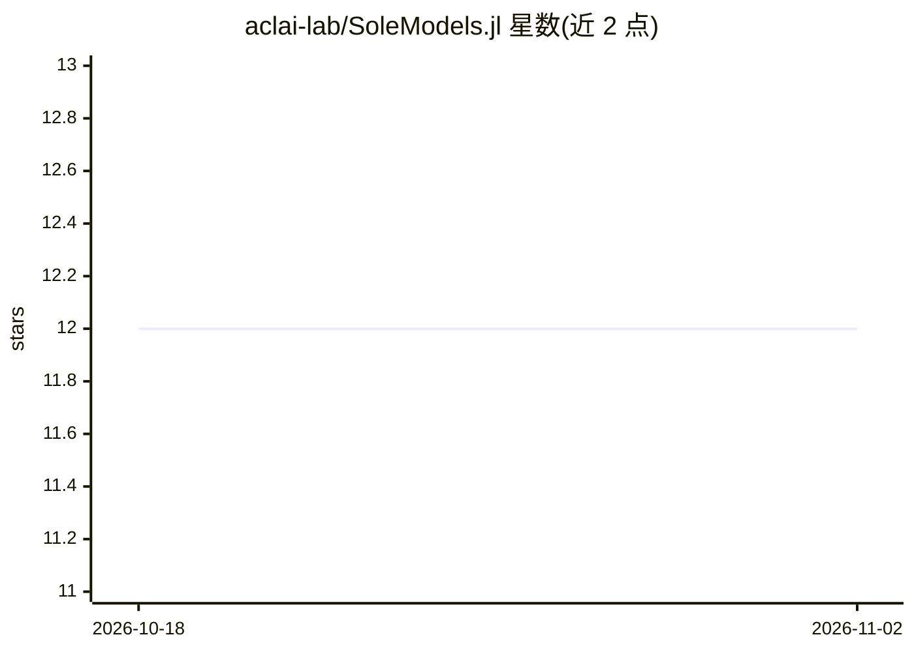

# aclai-lab/SoleModels.jl

⭐ 12 · Julia · MIT · 推送 2026-10-13 · [GitHub](https://github.com/aclai-lab/SoleModels.jl) · [官网](https://aclai-lab.github.io/SoleModels.jl/) · 组织维护

**面向符号机器学习的 Julia 模型构建块库**

意大利费拉拉大学 ACLAI Lab 开发的 Julia 包，定义符号建模与学习的基础构件：规则、分支、决策树/森林、决策列表、混合符号模型等符号模型结构，提供模型评估与从决策树中抽取规则的工具，并支持混合神经-符号计算。模型以逻辑公式作为前件，可应用于符号学习数据集的逻辑解释；底层依赖 SoleLogics.jl 与 SoleData.jl，是 Sole.jl 符号机器学习框架的核心模块。理论基础的博士学位论文于 2024 年给出。

## 筛选速览

| 维度 | 判定 | 备注 |
|---|---|---|
| AI 角色 | `ai-native` | 本体是模型或模型工具 |
| 许可风险 | `permissive` | MIT |
| 部署形态 | `None` |  |
| 模型依赖 | — | README 未给出锁定关系 |
| 硬件要求 | — | 无带数字的原话,不猜 |
| 安装摩擦 | `low` | 无编译、无系统依赖或容器化 |
| 成熟度 | — | 结构信号不足 |

## 能力要点

- 定义规则、分支、决策树/森林、决策列表等符号模型结构
- 提供模型评估与决策树规则抽取工具
- 支持混合神经-符号计算

## 适用场景

- 实现决策树/随机森林学习、规则抽取、关联规则挖掘等符号算法
- 从已训练的决策树中提取可解释规则
- 作为符号机器学习研究的统一基础库

## 场景标签

 · 领域:机器学习/符号学习

## 证据(README 行号)

> L10: *SoleModels.jl* defines the building blocks of *symbolic* modeling and learning.
> L67: The package is developed by the ACLAI Lab @ University of Ferrara.

## 星数曲线

2026-10-18 12 → 2026-11-02 12（+0）

---
*卡片 v1 · prompt 1.4 · 生成 2026-11-01 · 置信度 high · 依据 README sha `3b40c2afe8c8` · [字段定义](../../DATASET.md)*
