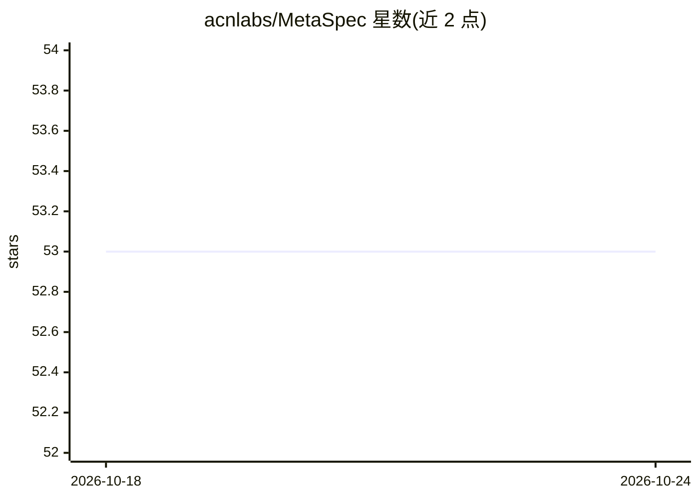

# acnlabs/MetaSpec

⭐ 53 · Jinja · MIT · 推送 2025-11-22 · [GitHub](https://github.com/acnlabs/MetaSpec) · [官网](https://mataspec.figma.site/) · 组织维护

**为 AI Agent 生成规格驱动工具包的元规格框架**

MetaSpec 是一个 Python 元规格框架，用于自动生成生产可用的 speckit（规格驱动工具包）：通过 metaspec init 交互式或命令式创建，产出含 CLI、解析器、校验器、模板与 AI agent 支持的独立工具包。规格按通用到专精分层细化并可模块化组合，生成的 speckit 内置 19 个覆盖 SDS/SDD/Evolution 生命周期的命令；0.5.4 引入行号级精准导航以降低 AI 读取 token。要求 Python 3.11+，状态为 Alpha。

## 筛选速览

| 维度 | 判定 | 备注 |
|---|---|---|
| AI 角色 | `ai-ecosystem` | LLM/agent 周边工具 |
| 许可风险 | `permissive` | MIT |
| 部署形态 | `library` | 以包/库形式分发 |
| 模型依赖 | — | README 未给出锁定关系 |
| 硬件要求 | — | 无带数字的原话,不猜 |
| 安装摩擦 | `low` | 无编译、无系统依赖或容器化 |
| 成熟度 | `idea` | |

## 能力要点

- metaspec init 一条命令生成含 CLI/解析器/校验器的独立 speckit
- 规格分层细化与模块化组合（按领域组合规格或按项目组合使用）
- 生成物内置 19 个生命周期命令，支持迭代感知的更新模式
- 行号级精准导航，README 称实测降低 84-99% token 消耗

## 适用场景

- 为特定领域（如 MCP 开发、API 校验）生成规格驱动工具包
- 通过结构化规格约束 AI agent 的生成结果
- 在社区注册表搜索、安装和分享 speckit

## 场景标签

`代码生成` · 领域:编码与开发

## 证据(README 行号)

> L17: **MetaSpec** is a meta-specification framework that enables AI Agents to automatically generate production-ready **
> L19: Define your speckit once → Get complete development environment with CLI, parser, validator, templates, and AI agen
> L214: MetaSpec is designed for AI agents with strong reasoning capabilities. Speckit creation requires meta-level system

## 星数曲线

2026-10-18 53 → 2026-10-24 53（+0）

---
*卡片 v1 · prompt 1.4 · 生成 2026-10-24 · 置信度 high · 依据 README sha `7d6776d78138` · [字段定义](../../DATASET.md)*
