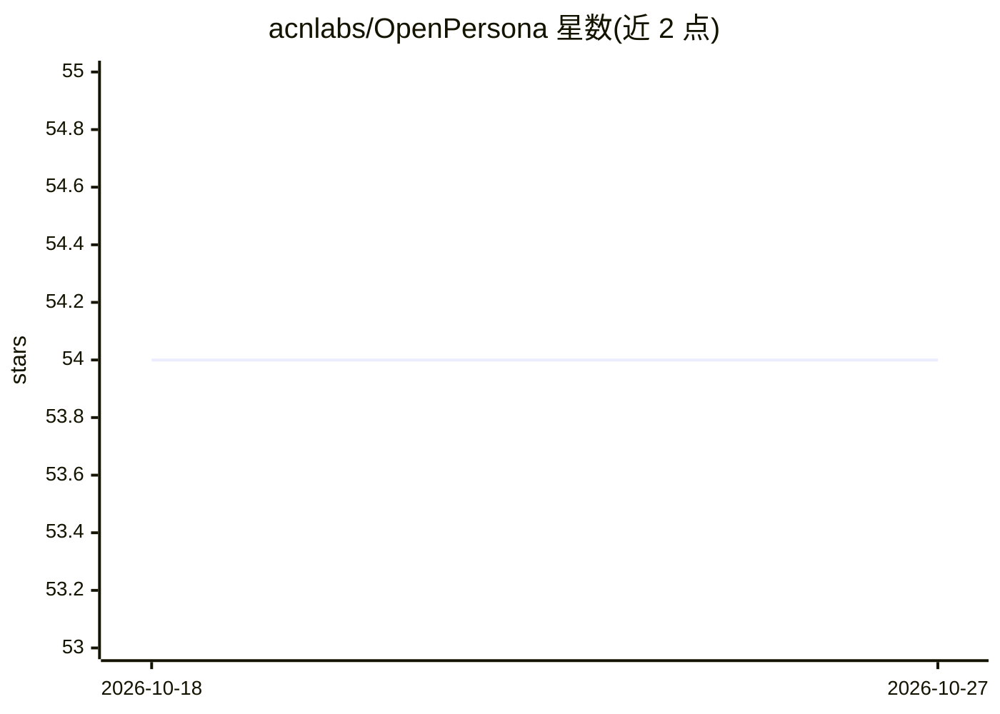

# acnlabs/OpenPersona

⭐ 54 · Jupyter Notebook · MIT · 推送 2026-08-11 · [GitHub](https://github.com/acnlabs/OpenPersona) · [官网](https://openpersona.co) · 组织维护

**四层架构的 AI persona 生命周期框架：声明、生成、约束与演化**

面向 AI agent 开发者的 persona 框架，采用 Soul/Body/Faculty/Skill 四层结构与 Generate/Install/Runtime 三道门。用户声明最简五个字段的 persona.json，生成器自动产出 SKILL.md 技能包、A2A Agent Card、宪法文件与状态同步脚本，兼容 OpenClaw、Cursor、Claude Code 等 37+ agent 运行时。支持跨会话记忆、人格演化（实验性）及边界治理、ERC-8004 链上身份、可插拔记忆后端（本地/Mem0/Zep）。提供配套技能：人物蒸馏、知识库构建、本地模型微调（Gemma/Qwen/Llama，经 Ollama/llama.cpp 运行）。

## 筛选速览

| 维度 | 判定 | 备注 |
|---|---|---|
| AI 角色 | `ai-ecosystem` | LLM/agent 周边工具 |
| 许可风险 | `permissive` | MIT |
| 部署形态 | `library` | 以包/库形式分发 |
| 模型依赖 | local-ok | 支持本地模型 |
| 硬件要求 | — | 无带数字的原话,不猜 |
| 安装摩擦 | `low` | 无编译、无系统依赖或容器化 |
| 成熟度 | `idea` | |

## 能力要点

- persona.json 声明式生成完整技能包，最简仅需五个字段
- 三道门（Generate/Install/Runtime）端到端强制执行声明约束
- Soul 演化（实验性）：关系阶段、情绪、特质漂移，含不可变特质与影响边界治理
- 配套 persona 流水线：蒸馏→知识库→本地微调（LoRA/GGUF）→经 Ollama/llama.cpp 运行

## 适用场景

- 为我的 agent 创建带持久记忆和人格的角色
- 把一个真人或角色蒸馏成可本地运行的 AI persona
- 多人格安装与即时切换（Pantheon），含上下文交接

## 场景标签

`Agent 框架` `微调` · 领域:Agent 开发

## 证据(README 行号)

> L3: An open, agent-agnostic lifecycle framework for AI agent personas — covering declaration, generation, constraint enf
> L26: |`open-persona`|`npx skills add acnlabs/OpenPersona`|Framework meta-skill — create, install, and manage personas|
> L65: Give your AI coding agent the ability to create and manage personas — works with Cursor, Claude Code, Codex, Windsu

## 星数曲线

2026-10-18 54 → 2026-10-27 54（+0）

---
*卡片 v1 · prompt 1.4 · 生成 2026-10-24 · 置信度 high · 依据 README sha `4ffee19197bd` · [字段定义](../../DATASET.md)*
