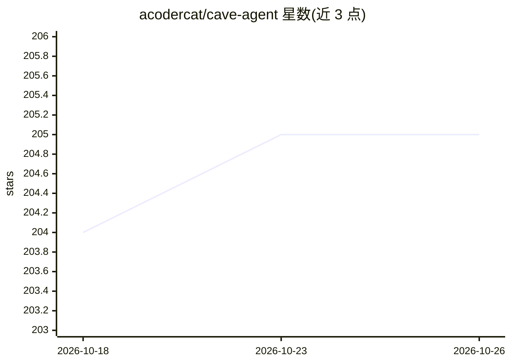

# acodercat/cave-agent

⭐ 205 · Python · MIT · 推送 2026-09-15 · [GitHub](https://github.com/acodercat/cave-agent) · [官网](https://caveagent.dev) · 个人维护

**让 LLM agent 直接操作 Python 对象的有状态运行时框架**

面向开发者的 LLM agent 框架，提供持久化 Python 运行时：可将 DataFrame、模型、数据库连接、自定义类实例作为一等变量注入，供 LLM 操纵并在多轮间持久保存，无需序列化进上下文窗口；执行后可取回原生 Python 对象。提供同进程 IPythonRuntime 与进程隔离 IPyKernelRuntime 两种后端，支持 AST 安全规则（明示非沙箱）、Agent Skills 标准（含 injection.py 扩展）、多级上下文压缩（CJK 感知估算）、超大输出绑定变量与按 token 计的运行预算。通过 pip 安装，需 Python 3.12+。

## 筛选速览

| 维度 | 判定 | 备注 |
|---|---|---|
| AI 角色 | `ai-ecosystem` | LLM/agent 周边工具 |
| 许可风险 | `permissive` | MIT |
| 部署形态 | `library` | 以包/库形式分发 |
| 模型依赖 | — | README 未给出锁定关系 |
| 硬件要求 | — | 无带数字的原话,不猜 |
| 安装摩擦 | `low` | 无编译、无系统依赖或容器化 |
| 成熟度 | — | 结构信号不足 |

## 能力要点

- 向运行时注入任意 Python 对象并在多轮间持久保存
- 两种运行时后端：同进程零拷贝与 IPython kernel 进程隔离
- Agent Skills 开放标准实现，扩展 injection.py 注入机制
- 多级上下文压缩（CJK 感知 token 估算、增量再压缩、断路器）

## 适用场景

- 让 agent 在多轮任务中持有并操作 DataFrame、数据库连接等复杂对象
- 在不把大输出塞入上下文的情况下分析超长执行结果
- 以进程隔离运行时执行不受信任的 agent 生成代码
- 用预算（token/步数/时长）约束 agent 单次运行成本

## 场景标签

`Agent 框架` · 领域:Agent 开发

## 证据(README 行号)

> L13: Most LLM agents operate under a text-in-text-out paradigm, with tool interactions constrained to JSON primitives. C
> L49: CaveAgent provides two runtime backends. Both share the same API for injecting functions, variables, and types — ch

## 星数曲线

2026-10-18 204 → 2026-10-26 205（+1）

---
*卡片 v1 · prompt 1.4 · 生成 2026-10-22 · 置信度 high · 依据 README sha `ab2e34ea3681` · [字段定义](../../DATASET.md)*
