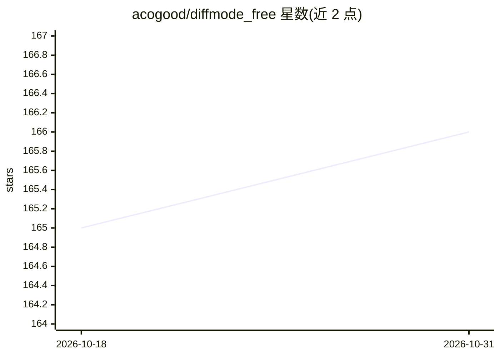

# acogood/diffmode_free

⭐ 166 · Python · Apache-2.0 · 推送 2026-08-10 · [GitHub](https://github.com/acogood/diffmode_free) · 个人维护

**面向初创创始人的增长策略研究工具：产出竞品分析与众筹式战术**

以 Claude Code 插件或 OpenAI Codex 脚本形式运行的本地增长策略生成流程：读取产品 URL 后，通过网络搜索研究竞品、绘制买家地图、挖掘 12–20 个真实案例并提炼增长机制，经盲配对与四道淘汰门槛（Marketer Test、Reframering Test、Emergence Proof、Anti-sameness）后输出 7–9 条战术卡片，全程约 90 分钟，免费无账号。研究后端默认用内置网络搜索，可选 Perplexity MCP（每轮约 $2–3）。免费版止于策略产出，完整版 diffmode.app 为商业付费产品。

## 筛选速览

| 维度 | 判定 | 备注 |
|---|---|---|
| AI 角色 | `ai-native` | 本体是模型或模型工具 |
| 许可风险 | `permissive` | Apache-2.0 |
| 部署形态 | `None` |  |
| 模型依赖 | locked-api |  |
| 硬件要求 | — | 无带数字的原话,不猜 |
| 安装摩擦 | `low` | 无编译、无系统依赖或容器化 |
| 成熟度 | — | 结构信号不足 |

## 能力要点

- 挖掘 12–20 个真实案例并保留来源、数字与失败模式
- 机制先盲配对再分析的固定顺序与四道淘汰门槛
- Claude Code 插件两命令安装，Codex 侧提供 python 脚本入口
- 同文件夹重跑可从断点恢复

## 适用场景

- 我不想在营销上砸钱，想找到竞品没注意到的获客打法
- 为我的产品生成竞品渠道分析与买家地图交给外包或放进融资 deck
- 在 Claude Code 里一条命令启动约 90 分钟的本地策略研究

## 场景标签

 · 领域:市场营销/增长策略

## 证据(README 行号)

> L3: **Growth tactics for startups that can't outspend their competitors.** It researches your market, mines public case 
> L5: Free. No account. Runs inside Claude Code or OpenAI Codex in about 90 minutes.
> L38: What's left becomes 7 to 9 tactics, each with a day-1 / day-7 / day-30 execution prototype and a "can a competitor 

## 星数曲线

2026-10-18 165 → 2026-10-31 166（+1）

---
*卡片 v1 · prompt 1.4 · 生成 2026-10-22 · 置信度 high · 依据 README sha `e10e5a5cd314` · [字段定义](../../DATASET.md)*
