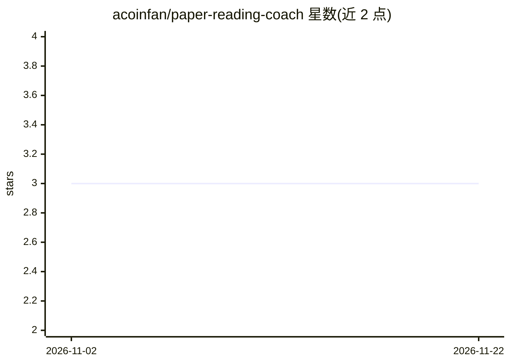

# acoinfan/paper-reading-coach

⭐ 3 · CC-BY-4.0 · 推送 2026-10-18 · [GitHub](https://github.com/acoinfan/paper-reading-coach) · 个人维护 · 中文 README

**把论文阅读训练法整理成 AI Agent 可执行的规则与模板**

将一套论文阅读训练方法整理为可直接交给 AI Agent 的规则、流程与模板：先让用户自述再纠正的训练模式、只认独立完成练习的技能升级机制、【原文/推断】证据标签体系、五轮阅读流程与读图五问套路。仓库含 MANUAL 手册、AGENTS 规则文件、笔记模板与真实示例。使用方式为复制文件到自建知识库目录（可作 Obsidian 仓库），由 Claude Code、Codex 等能读项目指令文件的 Agent 加载执行。内容采用 CC BY 4.0 许可。

## 筛选速览

| 维度 | 判定 | 备注 |
|---|---|---|
| AI 角色 | `ai-knowledge` | 知识聚合/清单类 |
| 许可风险 | `viral` | CC-BY-4.0 |
| 部署形态 | `None` |  |
| 模型依赖 | — | README 未给出锁定关系 |
| 硬件要求 | — | 无带数字的原话,不猜 |
| 安装摩擦 | `low` | 无编译、无系统依赖或容器化 |
| 成熟度 | — | 结构信号不足 |

## 能力要点

- 五轮阅读流程，每轮有明确阅读范围、问题与产出
- 严格的技能记录机制：仅独立完成的练习可升级状态
- 证据标签体系：原文、作者解释、推断、待验证分开标注
- 提供论文、方法、主题、图表、技能五种笔记模板

## 适用场景

- 让 Claude Code 类 Agent 带我按流程精读一篇论文
- 在 Obsidian 知识库里积累论文卡片与技能记录
- 训练自己看懂没见过的图并设计对照实验

## 场景标签

`知识库管理` `科研工具` · 领域:知识与检索

## 证据(README 行号)

> L7: 读论文的目标不是背下每篇论文，而是练出能迁移的能力：看懂实验在验证什么、读懂一张没见过的图、分清「能读出来」和「真的被用上」、想到替代解释并设计对照实验。这个仓库把一套实际跑通的训练方法整理成了可以直接交给 Agent 的规则、流程
> L14: - **一篇论文分五轮读**，每轮有明确的阅读范围、问题和产出，见 docs/five-round-reading.md。
> L22: |AGENTS.md|直接交给 Agent 的规则（Claude Code、Codex 等能读项目指令文件的 Agent 都可以用）|

## 星数曲线

2026-11-02 3 → 2026-11-22 3（+0）

---
*卡片 v1 · prompt 1.4 · 生成 2026-11-22 · 置信度 high · 依据 README sha `e03a4437eeec` · [字段定义](../../DATASET.md)*
