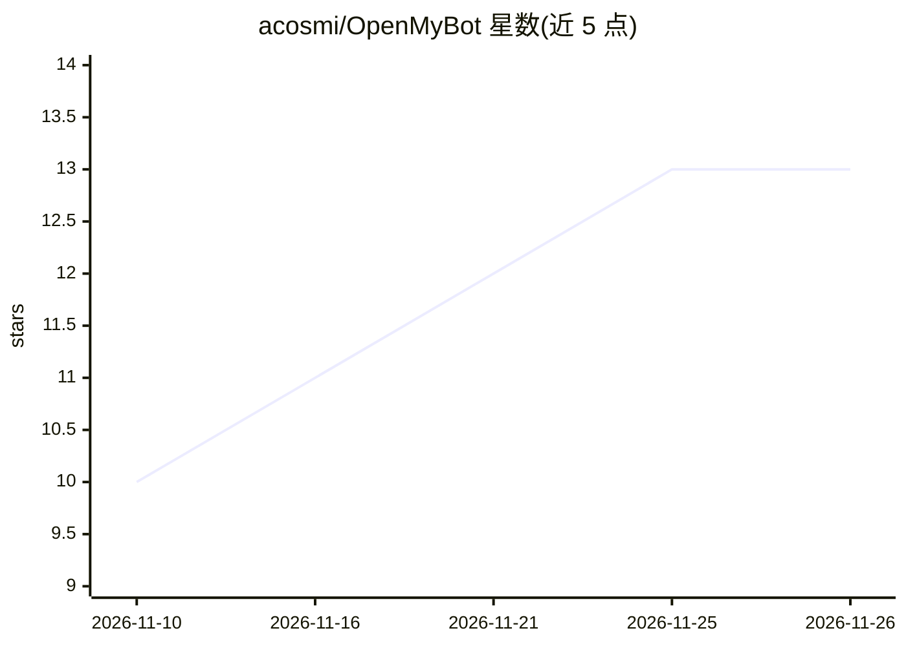

# acosmi/OpenMyBot

⭐ 13 · Rust · NOASSERTION · 推送 2026-11-24 · [GitHub](https://github.com/acosmi/OpenMyBot) · [官网](https://wrokbot.com) · 个人维护

**面向独立完成工作的 AI 员工/数字同事桌面平台**

以 Rust 构建的 AI 员工/数字同事平台，包含桌面宿主（Tauri）、服务器、Web 界面及开发中的移动客户端，macOS 为首个发布平台。核心机制：OpenBot 引擎拆分为 Wrok Bot（桌面与服务端产品面）与 OpenMyBot（本地前台守护进程、CrabCode 宿主驱动、MCP 服务器），聊天渠道以插件形式由所有者安装。服务器监听本机 127.0.0.1，远程部署要求同机 TLS 反向代理与共享密钥。项目状态为开发中，首次发布验证未完成，不提供安装包。

## 筛选速览

| 维度 | 判定 | 备注 |
|---|---|---|
| AI 角色 | `ai-native` | 本体是模型或模型工具 |
| 许可风险 | `none` | NOASSERTION |
| 部署形态 | `None` |  |
| 模型依赖 | — | README 未给出锁定关系 |
| 硬件要求 | — | 无带数字的原话,不猜 |
| 安装摩擦 | `low` | 无编译、无系统依赖或容器化 |
| 成熟度 | `idea` | |

## 能力要点

- Rust 核心 + Tauri 桌面端 + PostgreSQL 数据层
- OpenMyBot 提供 MCP 服务器并以 Agent Plugins 包接入 MCP 宿主
- 浏览器与计算机交互含人工接管与停止控制
- 服务器仅本地监听，远程部署经 TLS 反向代理与代理密钥鉴权

## 适用场景

- 让 AI 同事独立执行浏览器与桌面操作任务
- 通过 MCP 将本地 agent 能力接入宿主应用
- 本地单用户或经 TLS 反向代理的远程部署

## 场景标签

`多智能体` `浏览器自动化` `GUI 自动化` · 领域:Agent 开发

## 证据(README 行号)

> L20: Wrok Bot is an AI employee / digital teammate platform built with Rust, designed to provide AI coworkers who can ge
> L22: Wrok Bot and OpenMyBot are two products assembled from the same OpenBot engine in this workspace. Wrok Bot provides
> L34: |Model connections|Custom connection management, a persisted custom catalog, and a limited current-library custom v

## 星数曲线

2026-11-10 10 → 2026-11-26 13（+3）

---
*卡片 v1 · prompt 1.4 · 生成 2026-11-19 · 置信度 mid · 依据 README sha `7014f8fac759` · [字段定义](../../DATASET.md)*
