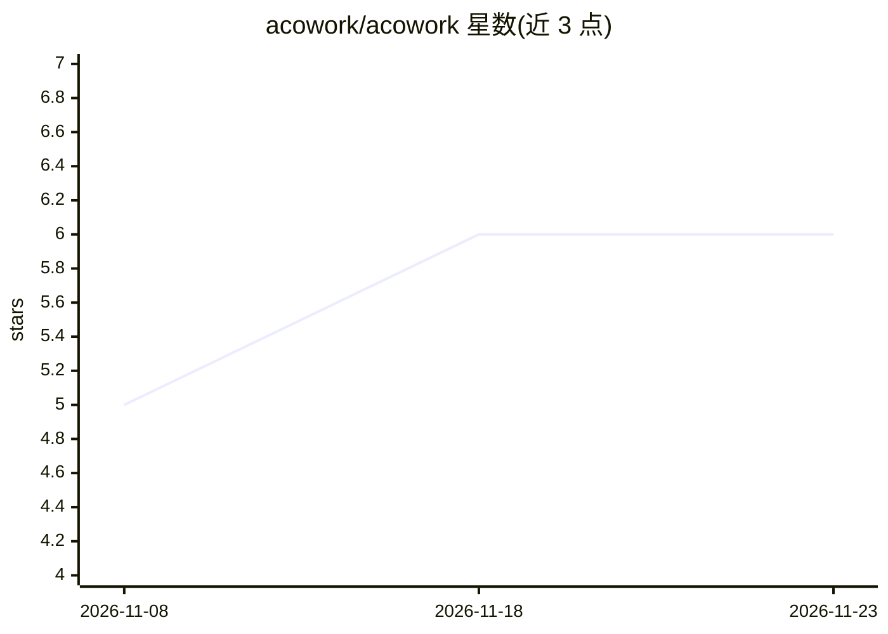

# acowork/acowork

⭐ 6 · Rust · Apache-2.0 · 推送 2026-11-20 · [GitHub](https://github.com/acowork/acowork) · [官网](https://acowork.ai) · 组织维护 · 中文 README

**人类与 AI agent 协作交付工作的多用户平台**

多用户、分布式的协作平台：人、AI agent、项目、文档共享同一运行时。架构分 Gateway→Node Agent→Runtime 三层，Gateway 提供 MQTT+HTTP 反向代理；每个 Agent 以独立 OS 进程运行，拥有私有文件系统、SQLite 分层记忆库（向量+FTS5 混合检索）与沙箱工具执行。会话分 Chat/Execute 两阶段，前者不持有执行工具。桌面端基于 Tauri v2，提供 Windows/macOS/Linux 安装包，可源码构建；单机与集群共用同一二进制。项目处于 Alpha 阶段。

## 筛选速览

| 维度 | 判定 | 备注 |
|---|---|---|
| AI 角色 | `ai-ecosystem` | LLM/agent 周边工具 |
| 许可风险 | `permissive` | Apache-2.0 |
| 部署形态 | `desktop` | 安装包/桌面程序 |
| 模型依赖 | — | README 未给出锁定关系 |
| 硬件要求 | — | 无带数字的原话,不猜 |
| 安装摩擦 | `low` | 无编译、无系统依赖或容器化 |
| 成熟度 | `idea` | |

## 能力要点

- 人、agent、项目、文档共享同一运行时，非侧边栏式隔离
- 每个 Agent 为独立进程，带分层记忆与打包时自动剥离敏感数据
- Gateway/Node/Runtime 单一二进制支持单机与集群
- 两阶段会话：Chat 规划不持执行工具，Execute 端到端运行

## 适用场景

- 团队与多个 agent 在同一项目中协作写规格、评审代码、交付功能
- 跨多台主机（GPU 工作站/云 VM）统一管理 agent 运行时
- 构建并分享带私有记忆隔离的 agent 包

## 场景标签

`Agent 框架` `多智能体` · 领域:Agent 开发

## 证据(README 行号)

> L24: ACowork is a **multi-user, distributed, AI-native collaboration platform**. People, AI agents, projects, and
> L49: Gateway sits a flat three-tier chain: **Gateway** → **Node Agent** → **Runtime**.
> L56: |**Runtime** · `acowork-runtime`|1 per `.agent`|loads the package, LLM loop, tool execution, loopback HTTP|

## 星数曲线

2026-11-08 5 → 2026-11-23 6（+1）

---
*卡片 v1 · prompt 1.4 · 生成 2026-11-20 · 置信度 high · 依据 README sha `356ffbb3c539` · [字段定义](../../DATASET.md)*
