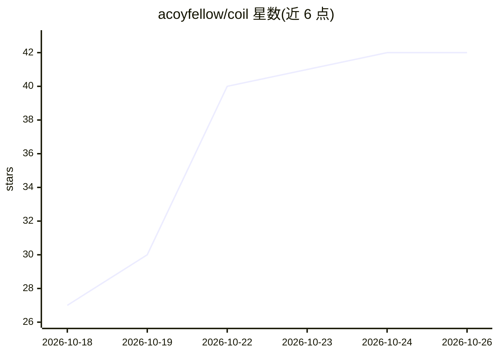

# acoyfellow/coil

⭐ 42 · TypeScript · MIT · 推送 2026-10-15 · [GitHub](https://github.com/acoyfellow/coil) · [官网](https://coil.coey.dev) · 个人维护

**在 Cloudflare 上为每个 agent 线程配备独立云电脑的平台**

单个 Cloudflare Worker 部署：每个线程是一个 Durable Object，运行 Pi agent 并拥有一个容器，容器内提供 tmux 终端、带头 Chrome（VNC 显示）、/workspace git 仓库，人与 agent 共用同一环境。支持线程暂停/分叉/压缩、子线程通信、定时循环、按人美元限额。默认用 Workers AI，可接 AI Gateway 或任意 OpenAI/Anthropic 兼容网关。提供 MCP、REST、/llms.txt 等接口供外部 agent 驱动。安装需 Bun、Docker 与 Workers Paid 账号，通过 bun run ship 部署。

## 筛选速览

| 维度 | 判定 | 备注 |
|---|---|---|
| AI 角色 | `ai-ecosystem` | LLM/agent 周边工具 |
| 许可风险 | `permissive` | MIT |
| 部署形态 | `self-host` | docker 或自建部署 |
| 模型依赖 | — | README 未给出锁定关系 |
| 硬件要求 | — | 无带数字的原话,不猜 |
| 安装摩擦 | `low` | 无编译、无系统依赖或容器化 |
| 成熟度 | — | 结构信号不足 |

## 能力要点

- 每线程一个 Durable Object + 容器：终端、Chrome、磁盘，人机共用
- MCP/REST/llms.txt 多接口，外部 agent 可无 UI 驱动
- 暂停/分叉/压缩、子线程派生与线程间消息
- Workers AI 默认，可选 AI Gateway 或 OpenAI/Anthropic 兼容网关，按线程选模型

## 适用场景

- 在云端给 coding agent 一台可远程共用的电脑（终端+浏览器）
- 通过 MCP 从其他 agent 工具链驱动 coil 线程
- 以 fork/compact 管理带磁盘状态的长期 agent 会话

## 场景标签

`Agent 框架` · 领域:Agent 开发

## 证据(README 行号)

> L16: coil is one Cloudflare Worker. Every thread is a Durable Object that runs a Pi agent and owns a Container. It insta
> L39: Once it is deployed, an agent can drive coil without the UI. One list of capabilities (`src/capabilities.ts`) drive
> L43: |`POST /mcp`|MCP. `coil_describe` returns a TypeScript declaration of the `coil` object. `coil_run` runs an async s

## 星数曲线

2026-10-18 27 → 2026-10-26 42（+15）

---
*卡片 v1 · prompt 1.4 · 生成 2026-10-25 · 置信度 mid · 依据 README sha `cb4037d5be95` · [字段定义](../../DATASET.md)*
