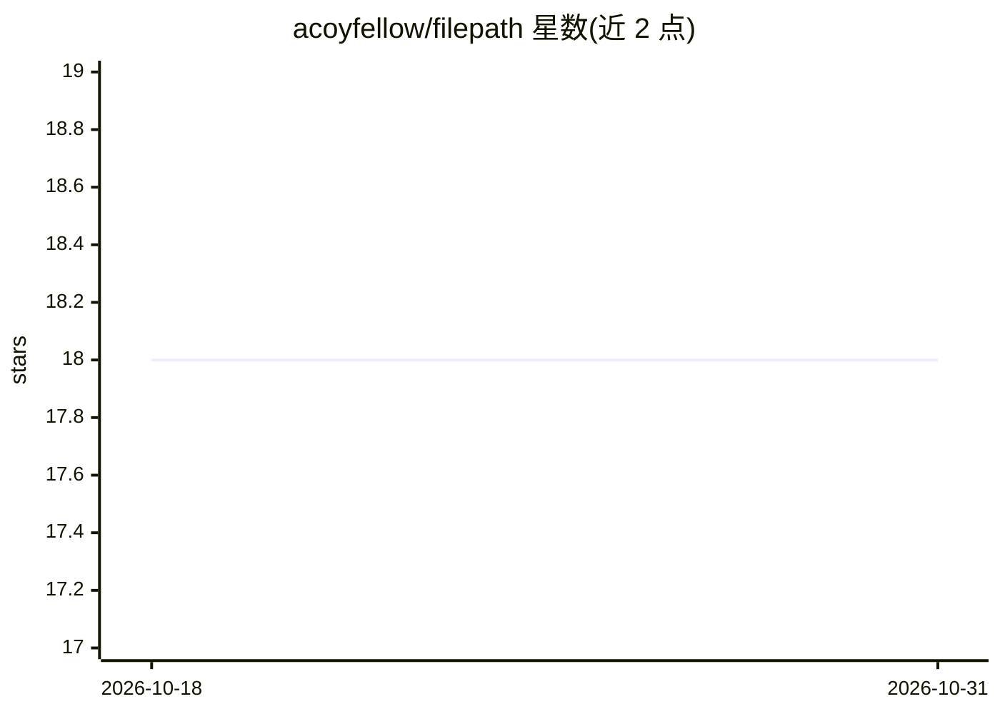

# acoyfellow/filepath

⭐ 18 · TypeScript · MIT · 推送 2026-06-14 · [GitHub](https://github.com/acoyfellow/filepath) · [官网](https://myfilepath.com) · 个人维护

**部署在 Cloudflare 上的个人开发环境：以对话形式调度受限 agent**

基于 SvelteKit 与 Cloudflare（D1、Worker、Durable Objects、沙箱容器）构建的个人开发环境，通过 Alchemy 部署。工作组织为工作区内的对话，每条对话绑定 harness（如 shelley、claude-code、codex、cursor 等）、模型与作用域：allowedPaths/forbiddenPaths 路径限制、六类工具权限、跨线程通信需显式授权。运行返回结构化结果（status、filesTouched、violations、diffSummary、patch 等）。作用域检查为纯函数实现，不依赖 LLM。自称非多用户平台、非证明引擎。

## 筛选速览

| 维度 | 判定 | 备注 |
|---|---|---|
| AI 角色 | `ai-ecosystem` | LLM/agent 周边工具 |
| 许可风险 | `permissive` | MIT |
| 部署形态 | `library` | 以包/库形式分发 |
| 模型依赖 | locked-api |  |
| 硬件要求 | — | 无带数字的原话,不猜 |
| 安装摩擦 | `low` | 无编译、无系统依赖或容器化 |
| 成熟度 | — | 结构信号不足 |

## 能力要点

- 对话式任务调度，绑定 harness、模型、路径作用域与工具权限
- 结构化运行结果与程序化 run API（含脚本模式，无 LLM）
- harness 注册表可切换（shelley/pi/claude-code/codex/cursor/amp/hermes 等）
- 确定性作用域与策略检查层，不依赖 LLM

## 适用场景

- 搭建个人自托管的 agent 开发工作台
- 对 agent 的文件访问与工具调用做细粒度权限控制
- 通过 API 以受限任务形式驱动外部工具或证明引擎

## 场景标签

`Agent 框架` · 领域:Agent 开发

## 证据(README 行号)

> L110: - A personal Better Auth-protected dashboard
> L180: Models and harnesses change fast. The durable value is the runtime boundary: a sandboxed workspace, scoped agents,

## 星数曲线

2026-10-18 18 → 2026-10-31 18（+0）

---
*卡片 v1 · prompt 1.4 · 生成 2026-10-29 · 置信度 mid · 依据 README sha `aee3bd28eca9` · [字段定义](../../DATASET.md)*
