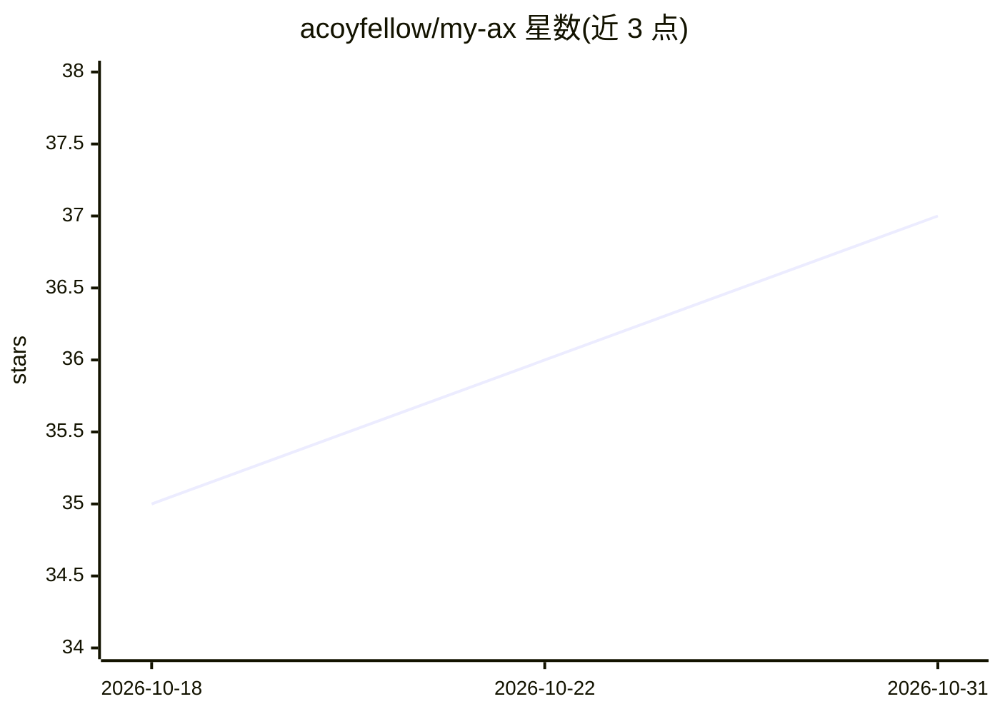

# acoyfellow/my-ax

⭐ 37 · TypeScript · MIT · 推送 2026-10-30 · [GitHub](https://github.com/acoyfellow/my-ax) · 个人维护

**自托管于 Cloudflare 的单操作者个人 AI agent 运行环境**

部署到用户自己 Cloudflare 账号的个人 agent 环境：agent 在容器沙箱写文件、通过安装在自有机器上的 companion 执行命令、在云端启动有界运行、用无头浏览器打开公开网页。采用“主人循环”模式——通过 Check-in/Attention/Desk 页面返回查看与审批，每个动作写可读回执。内置循环任务、最多 1000 个并行只读子任务委派、可复用的 Work Code、Svelte 5 UI artifact 构建。单一 Access 身份拥有全部会话与工具调用，MCP 连接器需 HTTPS 端点与 allowlist。需 Node 22、Docker、Python3 等依赖与付费 Cloudflare 资源授权。

## 筛选速览

| 维度 | 判定 | 备注 |
|---|---|---|
| AI 角色 | `ai-native` | 本体是模型或模型工具 |
| 许可风险 | `permissive` | MIT |
| 部署形态 | `None` |  |
| 模型依赖 | — | README 未给出锁定关系 |
| 硬件要求 | — | 无带数字的原话,不猜 |
| 安装摩擦 | `low` | 无编译、无系统依赖或容器化 |
| 成熟度 | — | 结构信号不足 |

## 能力要点

- 沙箱/自有机器/云端有界运行/无头浏览器四类执行位置，动作均写回执
- Check-in、Attention、Desk 构成的异步审批循环，含 Web Push 通知
- 单次调用最多 1000 个只读子任务并行委派（自适应窗口 32）
- create_svelte_artifact 编译自包含 Svelte 5 组件并在沙箱 iframe 中运行

## 适用场景

- 在自己 Cloudflare 账号上运行一个以本人身份行事的个人 agent
- 让 agent 在自有机器上以指定 OS 账户执行命令并留存回执
- 设置循环任务与并行委派批处理，异步回来审批结果

## 场景标签

`Agent 框架` `浏览器自动化` `工作流自动化` · 领域:Agent 开发

## 证据(README 行号)

> L3: **My AX is a single-operator agent. It acts with your authority. It works in a container, on a machine you connect, 
> L7: The agent does these tasks:

## 星数曲线

2026-10-18 35 → 2026-10-31 37（+2）

---
*卡片 v1 · prompt 1.4 · 生成 2026-10-25 · 置信度 high · 依据 README sha `f3e70334e06f` · [字段定义](../../DATASET.md)*
