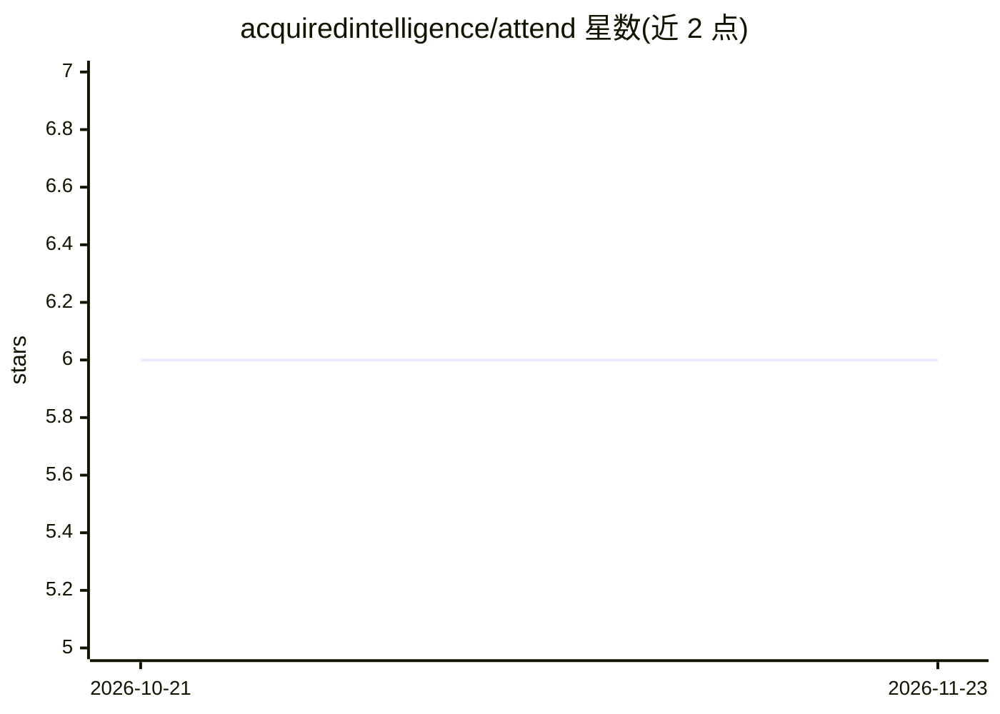

# acquiredintelligence/attend

⭐ 6 · TypeScript · MIT · 推送 2026-11-14 · [GitHub](https://github.com/acquiredintelligence/attend) · [官网](https://www.npmjs.com/package/@acquiredintelligence/attend) · 组织维护

**为 agent 提供事件唤醒决策：判断何时打断/排队/跳过**

一个 TypeScript 库（另有 asyncio Python 移植），将应用产生的事件流按 scope 聚合到结算窗口，由 judge 评估后输出六种路由之一（interrupt/queue/note/ask/wait/skip），应用据此决定是否唤醒 agent。嵌入进程内运行，或以 `attend serve` sidecar 方式通过 HTTP 与 MCP Events 交付决策。judge 可选 TypeSafe Jev、OpenAI Decisions API、任意模型的 llmJudge 或纯函数；存储支持 Memory/SQLite/Postgres/Redis。要求 Node 22.13+，仅 ESM，v0 阶段 API 可能变动，生产需替换真实 judge 并接入数据库存储。

## 筛选速览

| 维度 | 判定 | 备注 |
|---|---|---|
| AI 角色 | `ai-ecosystem` | LLM/agent 周边工具 |
| 许可风险 | `permissive` | MIT |
| 部署形态 | `library` | 以包/库形式分发 |
| 模型依赖 | — | README 未给出锁定关系 |
| 硬件要求 | — | 无带数字的原话,不猜 |
| 安装摩擦 | `low` | 无编译、无系统依赖或容器化 |
| 成熟度 | `idea` | |

## 能力要点

- 6 种路由决策：interrupt/queue/note/ask/wait/skip
- 4 种存储：Memory、SQLite、Postgres、Redis，CI 中逐提交边界崩溃测试
- 决策携带稳定 id，支持至少一次交付与去重
- 0 运行时依赖，可作为 MCP Events sidecar 供非 TypeScript 应用使用

## 适用场景

- 让 agent 在实时事件流中不被淹没，只在关键事件到来时被唤醒
- 多个 agent 共享同一个注意力服务，从同一事件源分流
- 非 TypeScript 应用通过 HTTP 接入事件决策

## 场景标签

`Agent 框架` `多智能体` · 领域:Agent 开发

## 证据(README 行号)

> L5:  Decide when an event should wake your agent.
> L19: attend holds each scope's events until they add up to something, asks a judge what the agent should do, and hands y
> L43: attend needs Node 22.13 or later and ships ESM only. The engine has no runtime dependencies. Before production, rep

## 星数曲线

2026-10-21 6 → 2026-11-23 6（+0）

---
*卡片 v1 · prompt 1.4 · 生成 2026-11-21 · 置信度 high · 依据 README sha `554d18294e33` · [字段定义](../../DATASET.md)*
