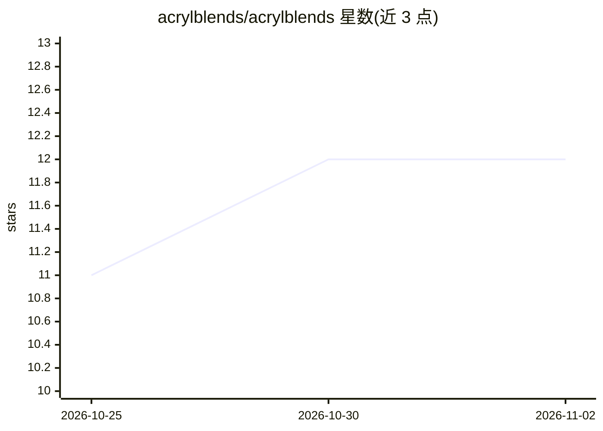

# acrylblends/acrylblends

⭐ 12 · TypeScript · MIT · 推送 2026-11-01 · [GitHub](https://github.com/acrylblends/acrylblends) · [官网](https://acrylblends.github.io) · 组织维护

**从 ACRYL 抽取的 Cordis 插件库，用于搭建 agentic 应用**

面向使用 Cordis 框架的开发者：将 ACRYL 应用中验证过的功能以可拥有的代码形式整理为插件库，提供 instance、settings、extensions（运行中安装/更新插件）、builder/agent（在应用内编写并安装插件的 agent）、tasks（运行与工具调用的持久记录）、manifest 与 save 等插件。附带 acrylblends 命令（init/add/plugins）将插件复制进应用，生成的应用为 TypeScript，由 Node 22.19+ 运行，无需构建步骤，运行时依赖 @deepseek-ai/cordis 与 yaml。README 自述为 prototype。

## 筛选速览

| 维度 | 判定 | 备注 |
|---|---|---|
| AI 角色 | `ai-ecosystem` | LLM/agent 周边工具 |
| 许可风险 | `permissive` | MIT |
| 部署形态 | `library` | 以包/库形式分发 |
| 模型依赖 | — | README 未给出锁定关系 |
| 硬件要求 | — | 无带数字的原话,不猜 |
| 安装摩擦 | `low` | 无编译、无系统依赖或容器化 |
| 成熟度 | `idea` | |

## 能力要点

- 运行中安装、更新与移除插件，失败更新保留旧版本
- agent 可在应用内编写、安装并检查插件
- tasks 插件持久记录每次运行与工具调用，重启后可读
- 单一 YAML 文件的可校验、分层、监听式设置

## 适用场景

- 基于 Cordis 搭建可动态扩展的 agentic 应用
- 让 agent 在运行中的应用内开发并安装新插件
- 以数据形式（blend.yaml）描述应用并追踪运行记录

## 场景标签

`Agent 框架` · 领域:Agent 开发

## 证据(README 行号)

> L5:  A framework for Cordis apps, built from ACRYL's best parts.
> L15: on top. It is a library of Cordis plugins extracted from ACRYL, and a command that copies them into your app:

## 星数曲线

2026-10-25 11 → 2026-11-02 12（+1）

---
*卡片 v1 · prompt 1.4 · 生成 2026-11-01 · 置信度 high · 依据 README sha `1de8332cdf03` · [字段定义](../../DATASET.md)*
