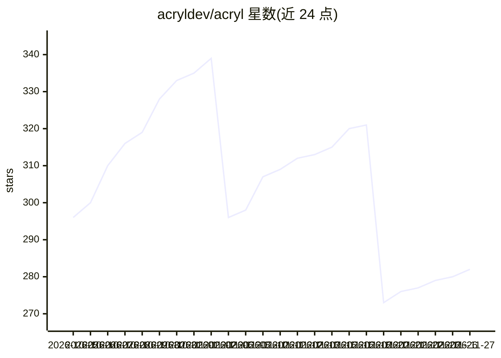

# acryldev/acryl

⭐ 282 · TypeScript · MIT · 推送 2026-11-26 · [GitHub](https://github.com/acryldev/acryl) · [官网](https://acryl.dev) · 组织维护

**插件化 agentic 应用平台：让用户用 agent 搭建并分享应用**

ACRYL 是构建 agentic 应用的开放平台与框架：应用由可替换的 Cordis 插件（页面、工具、服务）组装，内置 chat agent 及 Claude Code、Codex、Pi 等驱动器通过 app door 操作应用，核心代码保持不变；每个用户的改动是可版本化、可回滚、可分享到 GitHub 的 Blend 层。应用可运行于桌面、Web、CLI/TUI 或部署到 WebBox。需 Node.js 22.19+，通过 npx 安装脚本或源码构建（Corepack + PNPM）。MIT 许可。

## 筛选速览

| 维度 | 判定 | 备注 |
|---|---|---|
| AI 角色 | `ai-ecosystem` | LLM/agent 周边工具 |
| 许可风险 | `permissive` | MIT |
| 部署形态 | `library` | 以包/库形式分发 |
| 模型依赖 | — | README 未给出锁定关系 |
| 硬件要求 | — | 无带数字的原话,不猜 |
| 安装摩擦 | `low` | 无编译、无系统依赖或容器化 |
| 成熟度 | — | 结构信号不足 |

## 能力要点

- 应用全部由可热替换的 Cordis 插件组装，每个 app 一个 Host 进程
- 内置 chat agent 基于 pinned DeepSeek Harness，另支持 Claude Code/Codex/Pi 作为驱动器
- 改动以 Blend 形式版本化分层：保存、回滚、分享到 GitHub 与商店
- 支持桌面/Web/CLI-TUI 多形态运行及 WebBox 云部署

## 适用场景

- 让终端用户用自然语言在产品内添加自己需要的功能
- 基于商店中的 Blend 改制自己的应用并保留定制层
- 把插件化应用一键部署到自己的 WebBox 托管环境

## 场景标签

`Agent 框架` · 领域:Agent 开发

## 证据(README 行号)

> L38: Build agentic apps from plugins. Start blank, grow with an agent, share what you make. ACRYL is the open platform a
> L61: 2. **The agent builds with those blocks.** ACRYL's chat, and Claude Code, Codex or Pi, operate the app through its 

## 星数曲线

2026-10-25 296 → 2026-11-27 282（-14）

---
*卡片 v1 · prompt 1.4 · 生成 2026-11-26 · 置信度 high · 依据 README sha `816fc1843851` · [字段定义](../../DATASET.md)*
