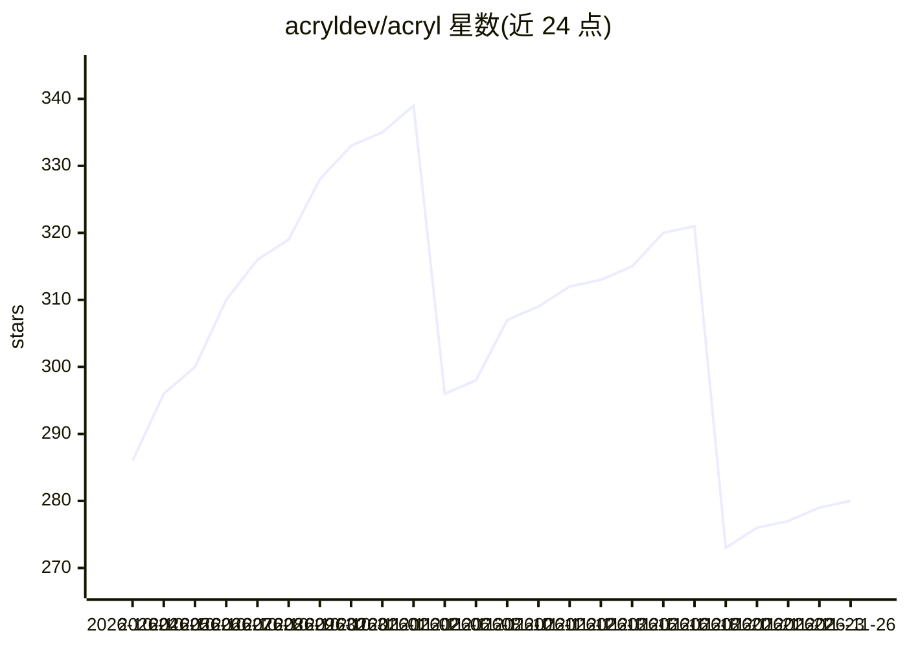

# acryldev/acryl

⭐ 280 · TypeScript · MIT · 推送 2026-11-25 · [GitHub](https://github.com/acryldev/acryl) · [官网](https://acryl.dev) · 个人维护

**供开发者用插件+内置 coding agent 构建和分享 agentic 应用的平台**

ACRYL 是构建 agentic 应用的开源平台与框架：应用由可热替换的 Cordis 插件组装，每个应用内含 agent，用户可通过自然语言让内置 chat 或 Claude Code/Codex/Pi 驱动应用变更，改动以可版本化、可回滚、可分享的 Blend 层保存。应用可运行于桌面/网页/终端 TUI，或部署到自托管 WebBox。仓库提供框架、运行时、插件与 acryl 命令；通过 npx 或 Release 安装包启动。构建其聊天 agent 基于 pin 的 DeepSeek Harness 检出版本。

## 筛选速览

| 维度 | 判定 | 备注 |
|---|---|---|
| AI 角色 | `ai-ecosystem` | LLM/agent 周边工具 |
| 许可风险 | `permissive` | MIT |
| 部署形态 | `library` | 以包/库形式分发 |
| 模型依赖 | — | README 未给出锁定关系 |
| 硬件要求 | — | 无带数字的原话,不猜 |
| 安装摩擦 | `low` | 无编译、无系统依赖或容器化 |
| 成熟度 | — | 结构信号不足 |

## 能力要点

- 应用由可热替换的 Cordis 插件组成，一切能力皆为插件
- 用户自然语言驱动 agent 修改应用，改动保存为可回滚的版本化 Blend
- 同一应用支持 CLI/TUI、桌面 GUI、Web 三种界面形态
- Blend 与插件可发布到 GitHub 与商店，供他人拉取与合并

## 适用场景

- 让终端用户自助扩展产品功能而无需改动源码
- 用 npx 一条命令从空白或商店模板启动一个带 agent 的应用
- 将 Blend 部署到自托管 WebBox 并与团队分享

## 场景标签

`编码 Agent` `Agent 框架` · 领域:Agent 开发

## 证据(README 行号)

> L22: Build agentic apps from plugins. Start blank, grow with an agent, share what you make. ACRYL is the open platform a
> L45: 2. **The agent builds with those blocks.** ACRYL's chat, and Claude Code, Codex or Pi, operate the app through its 
> L80: ACRYL builds on Cordis, the meta-framework of composable plugins, and on a pinned

## 星数曲线

2026-10-24 286 → 2026-11-26 280（-6）

---
*卡片 v1 · prompt 1.4 · 生成 2026-11-25 · 置信度 high · 依据 README sha `bab848cf4018` · [字段定义](../../DATASET.md)*
