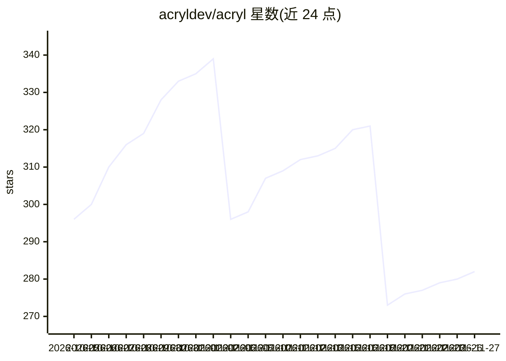

# acryldev/acryl

⭐ 282 · TypeScript · MIT · 推送 2026-11-26 · [GitHub](https://github.com/acryldev/acryl) · [官网](https://acryl.dev) · 组织维护

**用插件拼装 agentic 应用的开源平台，用户可用 agent 继续构建**

ACRYL 是构建与运行 agentic 应用的平台与框架：每个应用由可替换的 Cordis 插件（页面、工具、服务）组装，内置 chat agent 及 Claude Code、Codex、Pi 等 driver 通过稳定接口操作应用，核心代码不被改动。应用以 Blend 形式做版本化分层，可发布到 GitHub 与商店、按版本拉取更新并保留用户自己的改动层。支持终端 TUI、桌面 GUI、Web 三种 Control Center 形态，可部署到自有 WebBox。运行需 Node.js 22.19+、npm 与 git；源码构建需 Corepack 与 PNPM。

## 筛选速览

| 维度 | 判定 | 备注 |
|---|---|---|
| AI 角色 | `ai-ecosystem` | LLM/agent 周边工具 |
| 许可风险 | `permissive` | MIT |
| 部署形态 | `library` | 以包/库形式分发 |
| 模型依赖 | — | README 未给出锁定关系 |
| 硬件要求 | — | 无带数字的原话,不猜 |
| 安装摩擦 | `low` | 无编译、无系统依赖或容器化 |
| 成熟度 | — | 结构信号不足 |

## 能力要点

- 应用全部由可热替换的 Cordis 插件组成，Host 进程运行期换插件
- 内置 chat agent 与 Claude Code、Codex、Pi 可作为 driver 操作应用
- Blend 版本化分层：用户改动与上游更新可合并共存
- 同一命令提供 TUI、桌面、Web 三种运行形态与 WebBox 云部署

## 适用场景

- 让终端用户通过对话给应用加功能，开发者只维护底座
- 把应用以 Blend 分享到商店供他人拉取并二次修改
- 发布单个 Cordis 插件供其他应用复用
- 部署 Blend 到自托管的 WebBox 运行

## 场景标签

`Agent 框架` · 领域:Agent 开发

## 证据(README 行号)

> L38: Build agentic apps from plugins. Start blank, grow with an agent, share what you make. ACRYL is the open platform a
> L60: 1. **Building blocks, not source code.** Every app is assembled from Cordis plugins: UI, data and actions behind st
> L61: 2. **The agent builds with those blocks.** ACRYL's chat, and Claude Code, Codex or Pi, operate the app through its 

## 星数曲线

2026-10-25 296 → 2026-11-27 282（-14）

---
*卡片 v1 · prompt 1.4 · 生成 2026-11-27 · 置信度 high · 依据 README sha `01793b1f6fb8` · [字段定义](../../DATASET.md)*
