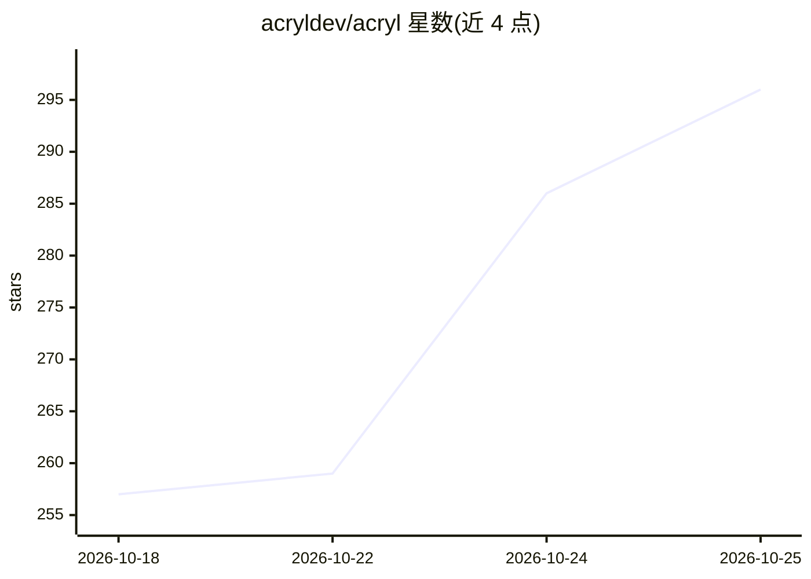

# acryldev/acryl

⭐ 296 · TypeScript · MIT · 推送 2026-10-24 · [GitHub](https://github.com/acryldev/acryl) · [官网](https://acryl.dev) · 组织维护

**多编码 Agent 共用持久上下文的 Agentic 开发环境运行时**

面向同时使用多个编码 Agent 的开发者：ACRYL 是一个持久化开发环境与运行时，Agent（Claude Code、Codex、OpenCode、Gemini CLI 等 33 个目录条目及自定义 Agent）作为可替换工人接入同一工作区，会话可丢弃而项目上下文、任务与交接记录持久保留。提供桌面（Electron）、CLI 与本地 Web 三种界面，基于 Cordis 插件体系，支持插件热重载与可分享的 Blend 组合。Agent Control 允许 Agent 读取无障碍树驱动应用本身，操作需逐次批准并记入审计日志。README 声明处于早期开发阶段，接口与打包可能变动。

## 筛选速览

| 维度 | 判定 | 备注 |
|---|---|---|
| AI 角色 | `ai-ecosystem` | LLM/agent 周边工具 |
| 许可风险 | `permissive` | MIT |
| 部署形态 | `library` | 以包/库形式分发 |
| 模型依赖 | — | README 未给出锁定关系 |
| 硬件要求 | — | 无带数字的原话,不猜 |
| 安装摩擦 | `low` | 无编译、无系统依赖或容器化 |
| 成熟度 | `idea` | |

## 能力要点

- 33 个编码 Agent 目录 + 自定义 Agent 接入同一持久工作区
- 桌面 / CLI / 本地 Web 三界面共享同一运行时
- 插件热重载体系与可分享的 Blend 整体组合
- Agent Control：Agent 可驱动应用本身，操作逐次批准并记录审计日志

## 适用场景

- 在不同编码 Agent 间切换而不丢失上下文与工作线程
- 同时运行多个 Agent 并通过注意力队列接收通知
- 以插件和 Blend 定制自己的 Agent 开发环境

## 场景标签

`Agent 框架` · 领域:Agent 开发

## 证据(README 行号)

> L5:  ACRYL is a living Agentic Development Environment and runtime for your agents — infinitely adaptive to you, yours t
> L6:  Bring any coding agent, it plugs in as a replaceable worker, and every decision, diff, and session survives the swa
> L35: Claude Code, Codex, OpenCode, Pi, Gemini CLI, DeepSeek Harness agents, ACP-compatible agents, plain PTY tools — eve

## 星数曲线

2026-10-18 257 → 2026-10-25 296（+39）

---
*卡片 v1 · prompt 1.4 · 生成 2026-10-22 · 置信度 high · 依据 README sha `3d42be87159e` · [字段定义](../../DATASET.md)*
