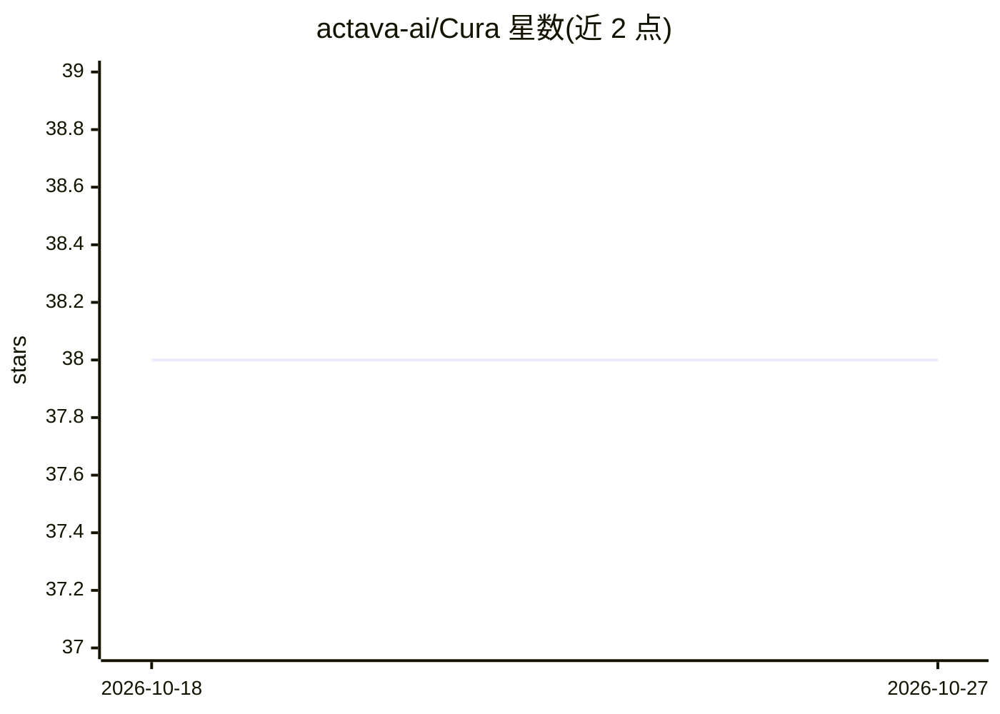

# actava-ai/Cura

⭐ 38 · Python · Apache-2.0 · 推送 2026-10-05 · [GitHub](https://github.com/actava-ai/Cura) · [官网](https://actava.ai/cura) · 组织维护

**面向医疗的万亿参数模型 Cura 1T 及配套医学评测工具 cura-eval**

actAVA 发布的仓库，包含两部分：一是 Cura 1T，基于 Kimi-K2.6 微调的一万亿参数医疗模型，经 OpenAI 兼容 API（等待名单获取 key）提供患者问诊对话、文本+医学影像临床推理（256K 上下文）、多轮交互诊断与 FHIR 病历工具调用等能力；二是 cura-eval，模型无关的医学评测 harness，覆盖 HealthBench、MedXpertQA、AgentClinic、MedAgentBench 等基准，任意 OpenAI 兼容端点（含本地 vLLM/SGLang/Ollama）均可作为被测模型。评测输出含逐例对话记录，可作为 SFT 数据。代码 Apache 2.0；模型声明为研究用途，不可替代临床医生。

## 筛选速览

| 维度 | 判定 | 备注 |
|---|---|---|
| AI 角色 | `ai-native` | 本体是模型或模型工具 |
| 许可风险 | `permissive` | Apache-2.0 |
| 部署形态 | `library` | 以包/库形式分发 |
| 模型依赖 | local-ok | 支持本地模型 |
| 硬件要求 | — | 无带数字的原话,不猜 |
| 安装摩擦 | `low` | 无编译、无系统依赖或容器化 |
| 成熟度 | — | 结构信号不足 |

## 能力要点

- Cura 1T：万亿参数医疗模型，支持文本+影像临床推理与 FHIR 病历工具调用
- cura-eval：模型无关评测 harness，任意 OpenAI 兼容端点可作被测模型
- 评测运行的 responses.jsonl 含完整对话与思维链，可复用为 SFT 数据
- 提供 Claude Code、Cline、Roo Code 等本地 agent 的接入配置示例

## 适用场景

- 通过 OpenAI 兼容 API 在医疗问诊、临床推理场景中调用 Cura 1T
- 用 cura-eval 对任意 OpenAI 兼容模型（含本地部署）做医学基准评测
- 复现技术报告中的评测结果或对比不同候选模型
- 将评测对话记录收集为微调训练数据

## 场景标签

`模型评测` · 领域:评测与运维

## 证据(README 行号)

> L17: **Cura 1T** is actAVA's one-trillion-parameter healthcare model. Fine-tuned from Kimi-K2.6 through
> L23: - **Patient consultation**: open-ended health conversations, graded hard by physician-written rubrics
> L51: The Cura API is OpenAI-compatible: base URL `https://inference.actava.ai/v1`, model id

## 星数曲线

2026-10-18 38 → 2026-10-27 38（+0）

---
*卡片 v1 · prompt 1.4 · 生成 2026-10-25 · 置信度 high · 依据 README sha `fe99c8e776f7` · [字段定义](../../DATASET.md)*
