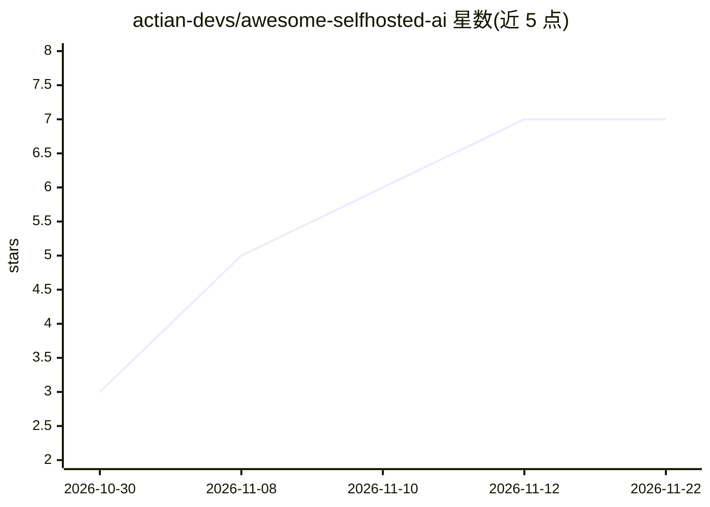

# actian-devs/awesome-selfhosted-ai

⭐ 7 · Python · CC0-1.0 · 推送 2026-11-16 · [GitHub](https://github.com/actian-devs/awesome-selfhosted-ai) · 组织维护

**自托管 AI 工具策展清单：模型、推理、向量库、Agent 等分类收录**

一个 awesome 类聚合清单，按 Agents 与记忆、向量数据库、RAG 编排、评测与可观测性、UI、数据集与基准、本地运行时、推理服务器、GPU 计算、部署基础设施、学习资源、隐私离线、开放权重模型、嵌入等板块组织条目，每条为项目名加一句功能描述。面向想在自己硬件上运行 AI 栈的用户，用于查找和比对工具。清单由 Actian 团队维护，含 Discord 社区入口；部分条目标注为专有许可。

## 筛选速览

| 维度 | 判定 | 备注 |
|---|---|---|
| AI 角色 | `ai-knowledge` | 知识聚合/清单类 |
| 许可风险 | `viral` | CC0-1.0 |
| 部署形态 | `None` |  |
| 模型依赖 | — | README 未给出锁定关系 |
| 硬件要求 | — | 无带数字的原话,不猜 |
| 安装摩擦 | `medium` | 含编译或系统依赖之一 |
| 成熟度 | — | 结构信号不足 |

## 能力要点

- 按 14 个板块组织自托管 AI 工具条目
- 覆盖本地运行时（llama.cpp/Ollama）与推理服务器（vLLM/TGI）
- 含数据集、基准与学习教程资源
- 部分条目标注专有许可状态

## 适用场景

- 搭建本地/自托管 LLM 栈前查找候选工具
- 按类别浏览向量数据库与 RAG 框架生态
- 寻找 LLM 评测、可观测性与部署方案
- 查找开放权重模型与嵌入模型资源

## 场景标签

`精选清单` · 领域:学习与行业

## 证据(README 行号)

> L1: # Awesome Self-Hosted AI Awesome
> L5: The full stack for running AI on your own hardware: models, inference, embeddings, vector databases, agents, GPUs, a

## 星数曲线

2026-10-30 3 → 2026-11-22 7（+4）

---
*卡片 v1 · prompt 1.4 · 生成 2026-11-20 · 置信度 high · 依据 README sha `73fcc9349478` · [字段定义](../../DATASET.md)*
