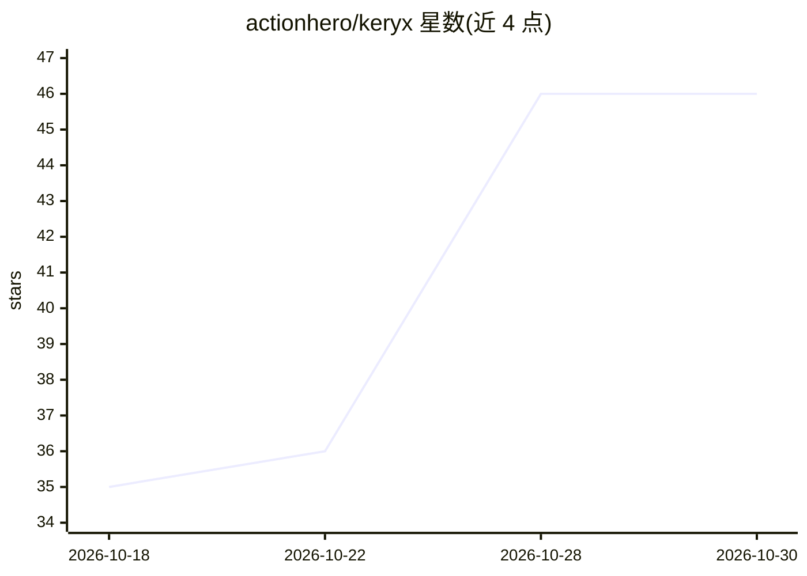

# actionhero/keryx

⭐ 46 · TypeScript · MIT · 推送 2026-10-22 · [GitHub](https://github.com/actionhero/keryx) · [官网](https://www.keryxjs.com) · 组织维护

**面向开发者的全栈 TypeScript 框架：一次编写的 Action 同时服务 MCP 与多种 API 传输**

基于 Bun 的全栈 TypeScript 后端框架：单个 Action 类可同时处理 HTTP、WebSocket、CLI、后台任务与 MCP 工具调用，共享同一 Zod 校验、中间件与响应结构。每个 Action 自动注册为 MCP 工具，AI agent 通过内置 OAuth 2.1（PKCE）认证调用。附带 Drizzle ORM 自动迁移、Redis 后台任务与扇出、流式响应（SSE/分块）、OpenAPI 生成，以及配套 Vite + React 前端。运行需 Bun、PostgreSQL 与 Redis（快速原型可无后两者）。项目自述为 Actionhero 的继任者。

## 筛选速览

| 维度 | 判定 | 备注 |
|---|---|---|
| AI 角色 | `ai-ecosystem` | LLM/agent 周边工具 |
| 许可风险 | `permissive` | MIT |
| 部署形态 | `self-host` | docker 或自建部署 |
| 模型依赖 | — | README 未给出锁定关系 |
| 硬件要求 | — | 无带数字的原话,不猜 |
| 安装摩擦 | `low` | 无编译、无系统依赖或容器化 |
| 成熟度 | — | 结构信号不足 |

## 能力要点

- 一个 Action 类同时作为 HTTP/WebSocket/CLI/后台任务/MCP 工具
- 每个 Action 自动注册为 MCP 工具，OAuth 2.1 + PKCE 认证
- Drizzle ORM 自动迁移、Redis 缓存与 fan-out 后台任务
- SSE/分块二进制流式响应跨传输统一处理，OpenAPI 自动生成

## 适用场景

- 把现有后端 Action 直接暴露给 Claude Desktop、VS Code 等 MCP 客户端调用
- 构建同时服务 HTTP API 与 AI agent 的全栈 TypeScript 应用
- 用统一控制器模式管理任务、命令行与实时 WebSocket 接口

## 场景标签

`Agent 框架` · 领域:Agent 开发

## 证据(README 行号)

> L13: That last transport — MCP — is the reason I built this now. Every action is automatically an MCP tool, so AI agents
> L67: - **MCP-native** — every action is an MCP tool with OAuth 2.1 auth, typed errors, and per-session isolation
> L177: When the MCP server is enabled (`MCP_SERVER_ENABLED=true`), every action is automatically registered as an MCP too

## 星数曲线

2026-10-18 35 → 2026-10-30 46（+11）

---
*卡片 v1 · prompt 1.4 · 生成 2026-10-25 · 置信度 high · 依据 README sha `59a6449be111` · [字段定义](../../DATASET.md)*
