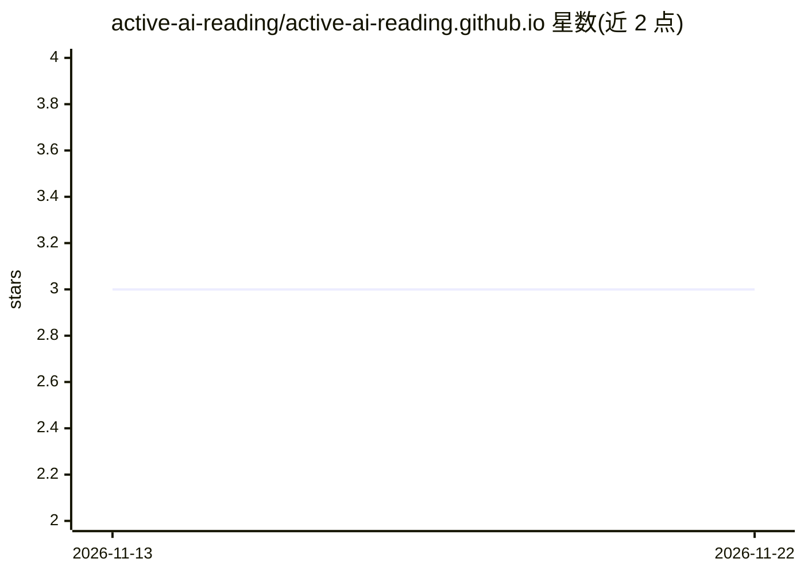

# active-ai-reading/active-ai-reading.github.io

⭐ 3 · HTML · MIT · 推送 2026-11-21 · [GitHub](https://github.com/active-ai-reading/active-ai-reading.github.io) · [官网](https://active-ai-reading.github.io) · 组织维护

**师生共读 AI 论文并改写/复现的 Jekyll 课程博客**

一个以 GitHub 仓库形式维护的课程博客站点：学生通过改写论文、批判评述、重绘图表、复现代码等方式主动阅读 AI 论文，任何人可直接提交到 main 分支，GitHub Actions 自动重建站点。内置角色分工与签署表、交接笔记（handoffs）、角色指南、论文与日程数据文件等课程协作机制，基于 al-folio v0.16.3 Jekyll 主题构建，README 含讲师一次性部署设置指南。

## 筛选速览

| 维度 | 判定 | 备注 |
|---|---|---|
| AI 角色 | `ai-knowledge` | 知识聚合/清单类 |
| 许可风险 | `permissive` | MIT |
| 部署形态 | `self-host` | docker 或自建部署 |
| 模型依赖 | — | README 未给出锁定关系 |
| 硬件要求 | — | 无带数字的原话,不猜 |
| 安装摩擦 | `low` | 无编译、无系统依赖或容器化 |
| 成熟度 | — | 结构信号不足 |

## 能力要点

- 改写/批判/复现式论文阅读的课程组织方式
- 角色指南 + 每周交接笔记的接力机制
- 无审批直接提交，GitHub Actions 自动重建站点
- bin/add_paper.py 脚本按 arXiv ID 添加论文

## 适用场景

- 为研究生课程搭建共读 AI 论文的博客
- 组织多人协作的论文复现与评述写作
- 需要人人可编辑、自动部署的课程站点

## 场景标签

`教程课程` · 领域:学习与行业

## 证据(README 行号)

> L5: A course where we read AI papers actively: we rewrite them, critique them, redraw their figures, rerun their code, t
> L74: - The site is built with al-folio **v0.16.3**, chosen because all its layouts and styles live in this repo (the v1 

## 星数曲线

2026-11-13 3 → 2026-11-22 3（+0）

---
*卡片 v1 · prompt 1.4 · 生成 2026-11-22 · 置信度 high · 依据 README sha `259a2811192b` · [字段定义](../../DATASET.md)*
