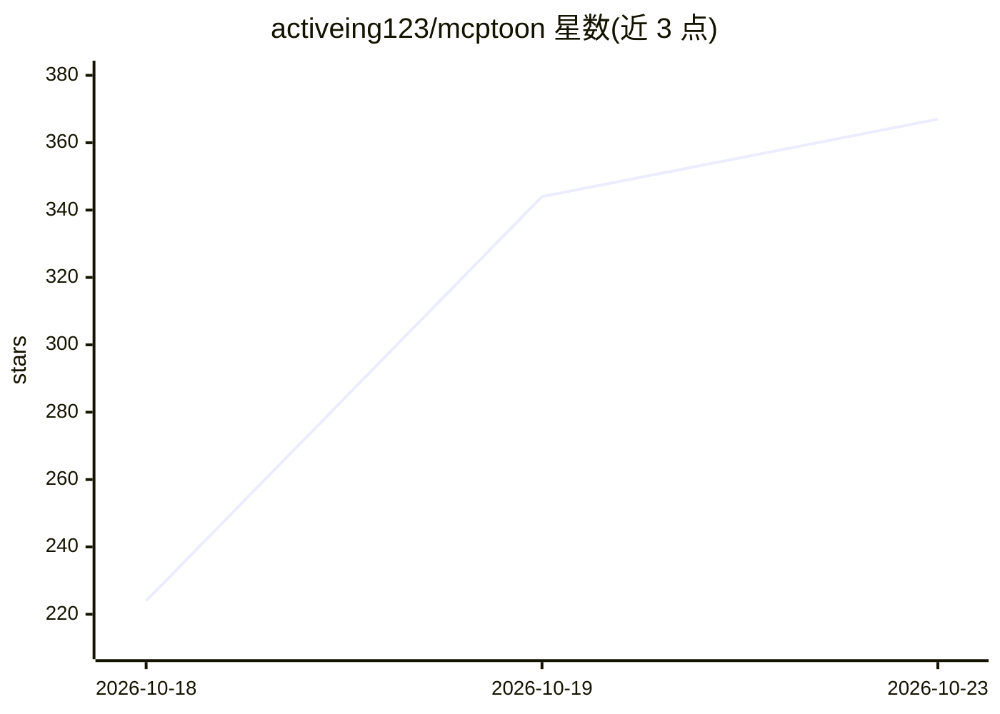

# activeing123/mcptoon

⭐ 367 · Python · Apache-2.0 · 推送 2026-10-22 · [GitHub](https://github.com/activeing123/mcptoon) · [官网](https://mcptoon.github.io/) · 个人维护 · 中文 README

**零依赖 CLI：统一管理 MCP 工具与技能，压缩上下文占用**

纯 Python 标准库实现的单文件 CLI（534KB，零依赖），用于统一管理本机 MCP 服务器、工具与 agent 技能。核心机制：将工具描述保留在磁盘、向 agent 提供紧凑名称索引（255 工具 581 tokens，-99.2%），schema 按需 inspect 获取；技能以 39 token 指针加查找替代完整 SKILL.md。任何可运行 shell 命令的 agent 可直接使用，sync 为 103+ GUI 客户端写入配置；另含 17,000+ 注册表搜索、OpenAPI/GraphQL 透传、OAuth、代码沙箱与安全检查。面向 AI 工具使用者与 MCP 开发者两类人群。

## 筛选速览

| 维度 | 判定 | 备注 |
|---|---|---|
| AI 角色 | `ai-ecosystem` | LLM/agent 周边工具 |
| 许可风险 | `permissive` | Apache-2.0 |
| 部署形态 | `library` | 以包/库形式分发 |
| 模型依赖 | — | README 未给出锁定关系 |
| 硬件要求 | — | 无带数字的原话,不猜 |
| 安装摩擦 | `low` | 无编译、无系统依赖或容器化 |
| 成熟度 | — | 结构信号不足 |

## 能力要点

- 紧凑名称索引：255 工具 581 tokens（-99.2%），schema 按需获取
- 零依赖纯标准库，534KB，支持 103+ 桌面与 CLI agent
- 17,000+ MCP 服务器注册表的自然语言搜索与一键安装
- OpenAPI/GraphQL 透传、OAuth（PKCE/DCR）、代码沙箱与安全防护检查

## 适用场景

- 我在多个 AI 客户端间共享同一套 MCP 工具，不想逐个改 JSON 配置
- 我装了大量工具和技能，想把上下文占用降下来
- 用自然语言搜索并按需调用 17,000+ MCP 服务器中的工具

## 场景标签

`Agent 框架` · 领域:Agent 开发

## 证据(README 行号)

> L34: It's a native CLI : any agent that can run a shell command gets every feature — no MCP server, no config. <code>syn
> L107: mcptoon is a **534KB, zero-dependency native CLI** that manages every MCP tool and agent skill on your computer — 
> L131: Script it. `mcptoon` is a plain CLI with stable JSON output and an `mcptoon serve` MCP endpoint — wire it into you

## 星数曲线

2026-10-18 224 → 2026-10-23 367（+143）

---
*卡片 v1 · prompt 1.4 · 生成 2026-10-22 · 置信度 mid · 依据 README sha `2182b8f2d076` · [字段定义](../../DATASET.md)*
