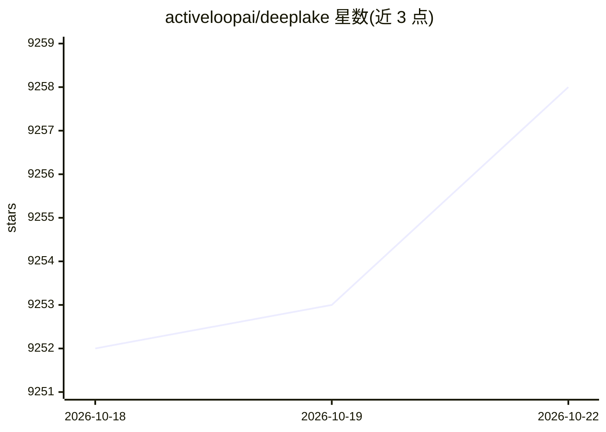

# activeloopai/deeplake

⭐ 9,258 · C++ · Apache-2.0 · 推送 2026-05-21 · [GitHub](https://github.com/activeloopai/deeplake) · [官网](https://deeplake.ai) · 组织维护

**面向 AI 的数据湖与向量存储数据库，存储多模态数据并支持检索训练**

由 Activeloop 维护的 AI 数据库/数据湖运行时，以面向深度学习优化的存储格式存储嵌入、图像、视频、音频、文本、PDF、DICOM 等多模态数据，提供向量搜索、数据版本管理与血缘、查询，以及 PyTorch/TensorFlow 内置 dataloader 用于模型训练流式读取。支持 S3/GCP/Azure/本地/内存等多种存储后端，可部署于用户自有云，计算在客户端执行。面向构建 LLM 应用与训练深度学习模型的开发者及企业；完整功能需注册 Deep Lake App。通过 pip 安装为 Python 包。

## 筛选速览

| 维度 | 判定 | 备注 |
|---|---|---|
| AI 角色 | `ai-ecosystem` | LLM/agent 周边工具 |
| 许可风险 | `permissive` | Apache-2.0 |
| 部署形态 | `library` | 以包/库形式分发 |
| 模型依赖 | — | README 未给出锁定关系 |
| 硬件要求 | — | 无带数字的原话,不猜 |
| 安装摩擦 | `low` | 无编译、无系统依赖或容器化 |
| 成熟度 | — | 结构信号不足 |

## 能力要点

- 多模态数据湖存储（嵌入、音视频、图像、DICOM、PDF 等）并支持向量搜索
- 内置 PyTorch/TensorFlow dataloader，支持训练时数据流式读取
- 数据版本控制与血缘，集成 LangChain/LlamaIndex/Weights & Biases 等
- 多云支持（S3/GCP/Azure/MinIO 兼容存储/本地/内存），serverless 客户端计算

## 适用场景

- 为 LLM 应用提供向量存储与检索
- 训练深度学习模型时管理大规模数据集并流式读取
- 对数据集做版本管理与可视化

## 场景标签

`向量数据库` `MLOps` · 领域:知识与检索

## 证据(README 行号)

> L17: Deep Lake is a Database for AI powered by a storage format optimized for deep-learning applications. Deep Lake can 
> L22: Deep Lake simplifies the deployment of enterprise-grade LLM-based products by offering storage for all data types (

## 星数曲线

2026-10-18 9,252 → 2026-10-22 9,258（+6）

---
*卡片 v1 · prompt 1.4 · 生成 2026-10-20 · 置信度 high · 依据 README sha `c7d432a54a13` · [字段定义](../../DATASET.md)*
