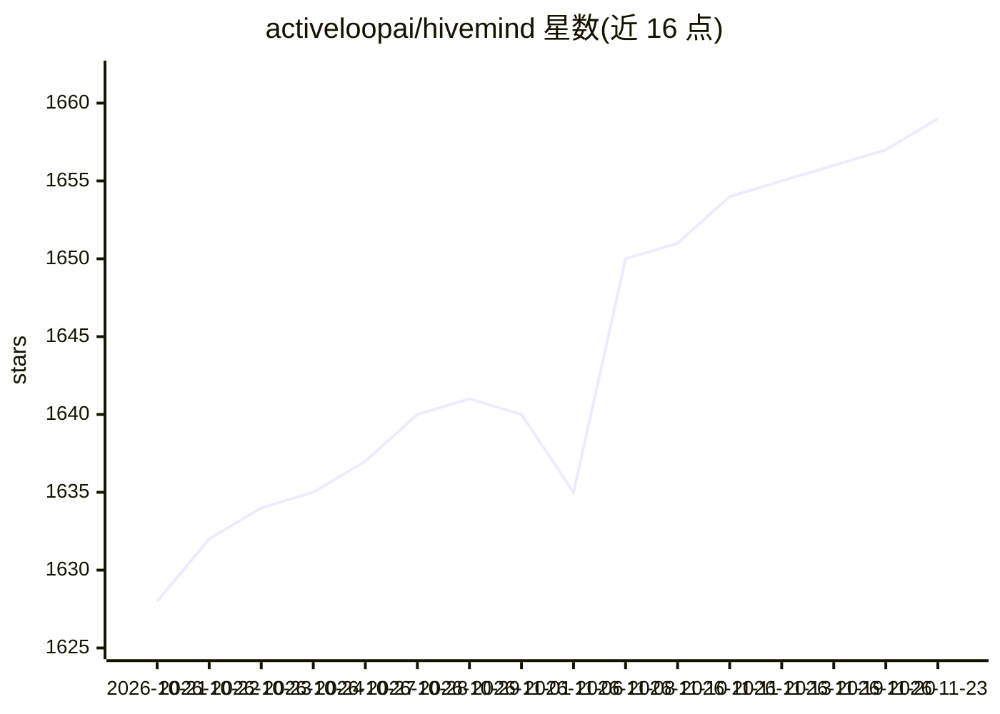

# activeloopai/hivemind

⭐ 1,659 · TypeScript · Apache-2.0 · 推送 2026-11-11 · [GitHub](https://github.com/activeloopai/hivemind) · [官网](https://deeplake.ai/hivemind) · 组织维护

**为多个编码 agent 提供共享记忆与可复用技能的中间层**

Hivemind 把各 agent 会话的提示词、工具调用与响应捕获为结构化 trace 存入 Deeplake，从重复模式中生成 SKILL.md 技能文件并实时同步给团队内的所有 agent。通过安装器自动检测本机的 Claude Code、OpenClaw、Codex、Cursor、Hermes、pi、Claude Cowork 并接入 hooks 或 MCP 服务器，支持混合词法+语义检索、会话总结为 wiki 页，以及 BYOC 方式将数据存入自己的 GCS/S3/Azure/on-prem 存储桶。需要 Node 22+（npm 路径），无 token 时共享记忆功能受限。

## 筛选速览

| 维度 | 判定 | 备注 |
|---|---|---|
| AI 角色 | `ai-ecosystem` | LLM/agent 周边工具 |
| 许可风险 | `permissive` | Apache-2.0 |
| 部署形态 | `self-host` | docker 或自建部署 |
| 模型依赖 | — | README 未给出锁定关系 |
| 硬件要求 | — | 无带数字的原话,不猜 |
| 安装摩擦 | `low` | 无编译、无系统依赖或容器化 |
| 成熟度 | — | 结构信号不足 |

## 能力要点

- 将团队 trace 挖掘为可复用 SKILL.md 并跨 agent 实时传播
- 接入 Claude Code/Codex/Cursor/OpenClaw/Hermes/pi 等 7 个助手
- 混合词法+语义检索（关闭 embeddings 时 ILIKE 词法回退）
- BYOC：数据可保留在自有 GCS/Azure/S3/on-prem 存储桶

## 适用场景

- 让团队成员的 agent 共享已解决的问题模式
- 降低编码 agent 的 token 消耗与对话轮次
- 把会话记录沉淀为可检索的知识库与 wiki 页面

## 场景标签

`Agent 记忆` `知识库管理` · 领域:Agent 开发

## 证据(README 行号)

> L17:  Auto-learning, cloud-backed shared brain for Claude Code • OpenClaw • Codex • Cursor • Hermes • pi • Claude Cowork
> L29: **Beyond memory.** Hivemind doesn't just remember. It mines your team's traces for repeated patterns and codifies t
> L31: - 📥 **Captures** every session's prompts, tool calls, and responses as structured traces in Deeplake

## 星数曲线

2026-10-21 1,628 → 2026-11-23 1,659（+31）

---
*卡片 v1 · prompt 1.4 · 生成 2026-11-23 · 置信度 mid · 依据 README sha `9bb959819407` · [字段定义](../../DATASET.md)*
