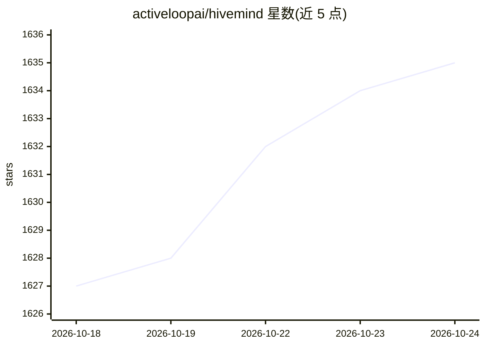

# activeloopai/hivemind

⭐ 1,635 · TypeScript · Apache-2.0 · 推送 2026-10-24 · [GitHub](https://github.com/activeloopai/hivemind) · [官网](https://deeplake.ai/hivemind) · 组织维护

**给编码 agent 团队的云端共享记忆与技能沉淀层**

面向使用 Claude Code、OpenClaw、Codex、Cursor 等 AI 编码助力的团队：把每次会话的 prompt、工具调用与响应捕获为存入 Deeplake 的结构化 trace，从中挖掘重复模式并固化为可复用的 SKILL.md 技能，通过混合词法+语义检索在会话间、agent 间与团队成员间实时传播；还可把会话总结为 AI 生成的 wiki 页面。支持 BYOC 将数据保存在自有 GCS/Azure/S3 桶。提供统一安装脚本、npm 安装与各 agent 专属安装路径。

## 筛选速览

| 维度 | 判定 | 备注 |
|---|---|---|
| AI 角色 | `ai-ecosystem` | LLM/agent 周边工具 |
| 许可风险 | `permissive` | Apache-2.0 |
| 部署形态 | `self-host` | docker 或自建部署 |
| 模型依赖 | — | README 未给出锁定关系 |
| 硬件要求 | — | 无带数字的原话,不猜 |
| 安装摩擦 | `low` | 无编译、无系统依赖或容器化 |
| 成熟度 | `idea` | |

## 能力要点

- 捕获会话 trace 到 Deeplake 并固化为可复用 SKILL.md
- 混合词法+语义检索（嵌入关闭时回退 ILIKE 词法）
- 支持 Claude Code/OpenClaw/Codex/Cursor/Hermes/pi/Claude Cowork 等 agent 接入
- BYOC 数据可存自有 GCS/Azure/S3 或本地部署桶

## 适用场景

- 团队成员的 agent 学到的模式共享给全组其他 agent
- 跨会话与跨 agent 检索历史 trace 与技能
- 把会话自动总结为团队 wiki 页面

## 场景标签

`Agent 记忆` `知识库管理` · 领域:Agent 开发

## 证据(README 行号)

> L17:  Auto-learning, cloud-backed shared brain for Claude Code • OpenClaw • Codex • Cursor • Hermes • pi • Claude Cowork
> L31: - 📥 **Captures** every session's prompts, tool calls, and responses as structured traces in Deeplake
> L32: - 🧠 **Codifies** patterns into reusable `SKILL.md` files, available to every agent on your team

## 星数曲线

2026-10-18 1,627 → 2026-10-24 1,635（+8）

---
*卡片 v1 · prompt 1.4 · 生成 2026-10-21 · 置信度 mid · 依据 README sha `1414ae4e2f17` · [字段定义](../../DATASET.md)*
