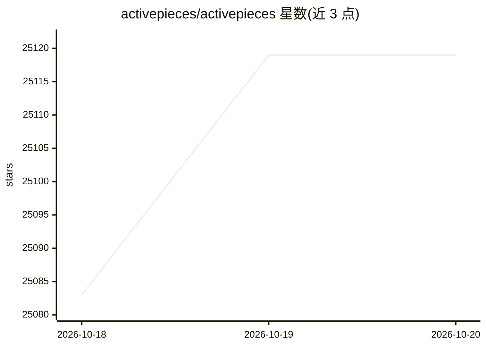

# activepieces/activepieces

⭐ 25,119 · TypeScript · NOASSERTION · 推送 2026-10-19 · [GitHub](https://github.com/activepieces/activepieces) · [官网](https://www.activepieces.com) · 组织维护

**开源 AI 工作流自动化平台：为 AI 代理提供 MCP 工具集**

Activepieces 是用 TypeScript 编写的可扩展自动化平台，通过类型安全的 pieces 框架提供 200+ 集成（如 Google Sheets、Discord、RSS），覆盖循环、分支、重试、HTTP、代码块等构建器功能，并提供无代码构建器供非技术用户使用。所有 pieces 自动可作为 MCP server 供 LLM 客户端调用；内置原生 AI pieces 与 AI SDK 用于创建 agent 和构建流程，支持人工审批、延迟执行、聊天/表单人工输入触发。社区版 MIT 许可，企业功能采用商业许可。

## 筛选速览

| 维度 | 判定 | 备注 |
|---|---|---|
| AI 角色 | `ai-native` | 本体是模型或模型工具 |
| 许可风险 | `dual` | NOASSERTION |
| 部署形态 | `None` |  |
| 模型依赖 | — | README 未给出锁定关系 |
| 硬件要求 | — | 无带数字的原话,不猜 |
| 安装摩擦 | `low` | 无编译、无系统依赖或容器化 |
| 成熟度 | — | 结构信号不足 |

## 动量与使用信号

- 维护:`active` — 距上次 push 0.6 天,年发版 95,357 位贡献者
- 涨星:近 1 天 **+15**(自 20261016 起算)
- 安装:github 包 `release-assets` 月下载无数据
- 平台:— · 协议:MCP

## 能力要点

- 280+ pieces 自动作为 MCP servers，供 Claude Desktop、Cursor、Windsurf 等 LLM 客户端使用
- 原生 AI pieces 与 AI SDK，可在构建器内创建 agent
- TypeScript pieces 框架，npm 包形式发布，支持本地开发热重载
- 支持人工审批、延迟执行与聊天/表单人工输入触发

## 适用场景

- 用无代码构建器搭建跨 200+ 服务的自动化工作流
- 为 AI 代理（如 Claude Desktop、Cursor）提供 280+ MCP 工具
- 构建需要人工审批环节的企业自动化流程
- 自托管、断网环境下的内部自动化平台

## 场景标签

`工作流自动化` · 领域:效率与自动化

## 证据(README 行号)

> L39: All-in-one AI automation designed to be **extensible** through a **type-safe** pieces framework written in **TypeSc
> L48: - **🛠️ Largest open source MCP toolkit**: All our pieces (280+) are available as MCP that you can use with LLMs on 
> L52: - **🤖 AI-First**: Native AI pieces let you experiment with various providers, or create your own agents using our A

## 星数曲线

2026-10-18 25,083 → 2026-10-20 25,119（+36）

---
*卡片 v1 · prompt 1.4 · 生成 2026-10-18 · 置信度 high · 依据 README sha `dd569bae4a08` · [字段定义](../../DATASET.md)*
